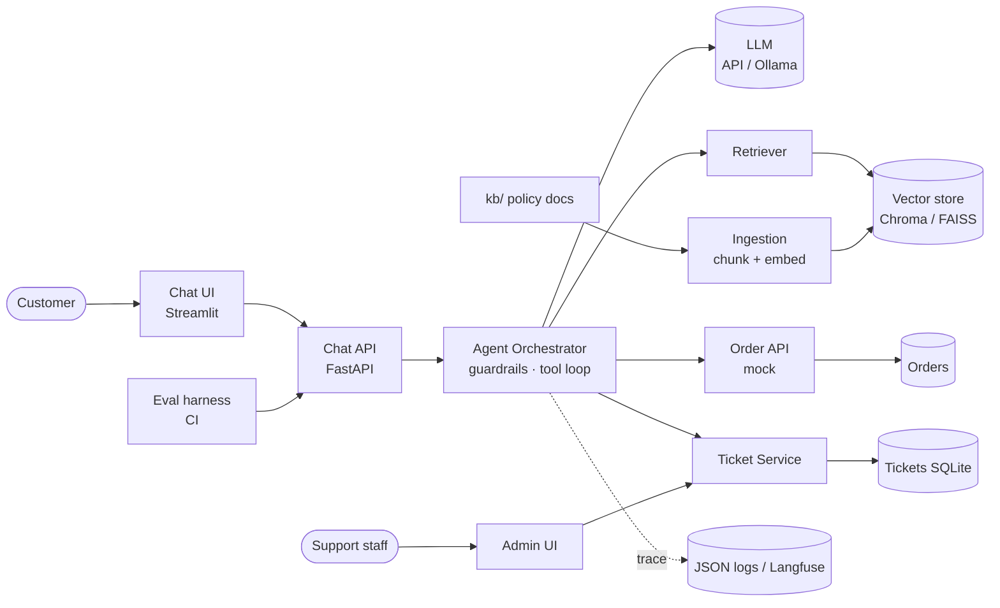

# Customer Support Agent (ShopX)

> LLM-powered support assistant for a fictional e-commerce company: answers policy questions from
> documents with citations (RAG), looks up orders after verifying the customer, creates tickets and
> hands off to human agents — with an automated evaluation harness running in CI.

| | |
|---|---|
| **Team code** | AIE-01 · AI Engineering track |
| **Members** | Nguyễn Quốc Trọng · Trần Minh Khôi |
| **Mentor** | Nguyễn Trần Anh Quân |
| **Timeline** | 4 sprints × 1 week · spec v1.0 (14/11/2026) |
| **Status** | 🚧 Sprint 0 – scaffold |

## Highlights

- **Retrieval-Augmented Generation** with source citations over a versioned knowledge base
- **Hand-written tool-calling loop** with Pydantic-validated arguments (no heavy agent framework)
- **Guardrails** on input and output: prompt-injection defense, no order data before verification
- **Automated evaluation harness** (LLM-as-judge, citation / tool / handoff checks) running in CI
- **Observability**: per-turn traces with tokens, cost, step latency, tools and retrieved chunks
- **Micro-service layout**: Chat API, mock Order API, Ticket Service, Streamlit UIs — Docker Compose + GitHub Actions

## Architecture



## Repository structure

```text
customer-support-agent/
├── configs/agent.yaml        # versioned agent parameters (top-k, limits, prices)
├── docs/                     # PRD, DESIGN, adr/, reports/ (WSR), EVAL_REPORT, ...
├── eval/                     # datasets/<version>/cases.jsonl, run_eval.py, reports/
├── kb/                       # ShopX policy documents (Markdown) — doc_id = file name
├── prompts/                  # system/<version>.md, tools/<version>.json
├── scripts/                  # generate_orders.py, ingest_kb.py
├── services/
│   ├── chat_api/             # FastAPI app exposing /v1/chat
│   ├── order_api/            # mock Order API (separate service)
│   └── ui/                   # Streamlit chat UI + admin UI
├── support_agent/            # core package
│   ├── llm/                  # provider-agnostic client + deterministic MockLLM
│   ├── retrieval/            # ingestion + retriever
│   ├── tools/                # tool registry, get_order_status, create_ticket, handoff
│   ├── guardrails.py · memory.py · orchestrator.py · tracing.py · config.py
├── tests/unit/
├── docker-compose.yml
├── Makefile
└── .env.example
```

## Getting started

```bash
cd customer-support-agent
python -m venv .venv && source .venv/bin/activate   # Windows: .venv\Scripts\activate
make install                 # package + dev tools
cp .env.example .env         # LLM_PROVIDER=mock works without any API key
make orders                  # synthetic orders → var/orders.json
make test                    # unit tests
make run                     # http://localhost:8000/docs
```

With Docker:

```bash
cp .env.example .env
make up      # chat-api :8000 · order-api :8001 · chat-ui :8501
```

Try it:

```bash
curl -s localhost:8000/v1/chat -H 'content-type: application/json' \
  -d '{"session_id":"demo","message":"How long does delivery to Hanoi take?"}'
```

## Evaluation

```bash
make eval      # full eval against the running API → eval/reports/eval_<timestamp>.{md,csv}
make eval-ci   # reduced, in-process, mock LLM (what CI runs)
```

## Requirements traceability

| ID | Requirement | Priority | Where | Status |
|---|---|---|---|---|
| FR-01 | `POST /v1/chat` → answer, citations, actions | Must | `services/chat_api` | 🟨 contract ready |
| FR-02 | Ingestion pipeline (chunk, embed, store, re-runnable) | Must | `support_agent/retrieval/ingest.py` | 🟨 chunking baseline |
| FR-03 | RAG answers with citations / "not found" → handoff | Must | `orchestrator.py`, `retriever.py` | ⬜ |
| FR-04 | `get_order_status(order_id, email)` with verification | Must | `tools/order_status.py`, `services/order_api` | 🟨 schema ready |
| FR-05 | `create_ticket(category, summary, priority)` | Must | `tools/ticket.py` | 🟨 schema ready |
| FR-06 | Human handoff rules | Must | `tools/ticket.py`, `orchestrator.py` | ⬜ |
| FR-07 | Multi-turn memory per session | Should | `memory.py` | 🟨 in-memory |
| FR-08 | Chat UI with citations + admin ticket UI | Should | `services/ui` | 🟨 skeleton |
| FR-09 | Vietnamese + English | Could | prompts, kb | ⬜ |
| FR-10 | Answer feedback | Could | — | ⬜ |

| NFR | Target |
|---|---|
| NFR-01 Answer quality | ≥ 80% correct on ≥ 60 cases (LLM-as-judge, 20 samples manually verified) |
| NFR-02 Grounding | ≥ 90% of policy answers cite the right document |
| NFR-03 Tool use | ≥ 90% correct tool + args; **0** order leaks before verification |
| NFR-04 Handoff | Recall ≥ 90% on mandatory-handoff cases; precision reported |
| NFR-05 Safety | ≥ 8/10 prompt-injection & out-of-scope scenarios handled |
| NFR-06 Latency | p95 ≤ 6 s per turn over 50 turns |
| NFR-07 Cost & observability | tokens, cost, step latency, tools, chunks logged per turn |
| NFR-08 Reproducibility | versioned prompts, config files, one-command eval |

## Sprint plan

| Sprint | Theme | Key outputs |
|---|---|---|
| 1 | Discovery & Design | PRD v1.0, Design Doc v0, ≥ 20 kb docs, 100 synthetic orders, eval set v0 (30 cases), RAG spike |
| 2 | Walking Skeleton | Chat API → RAG → cited answer end-to-end in Docker, order tool, eval harness v1, ≥ 3 ADRs |
| 3 | Feature Complete & Evaluation | tickets, handoff, guardrails, UIs, eval set 60 + 10 attacks, Test Plan, Eval Report |
| 4 | Hardening & Release | improvements from eval, cost/latency tuning, `csa-v1.0.0`, Runbook, Prompt Card, Postmortem |

## Licenses

| Component | License |
|---|---|
| This code | MIT |
| ShopX documents & orders | Synthetic, written by the team |
| Embedding model | Fill in (e.g. multilingual-e5: MIT) |
| LLM | Fill in per ADR-0002 |
