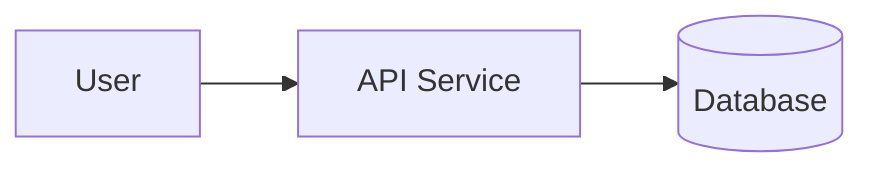
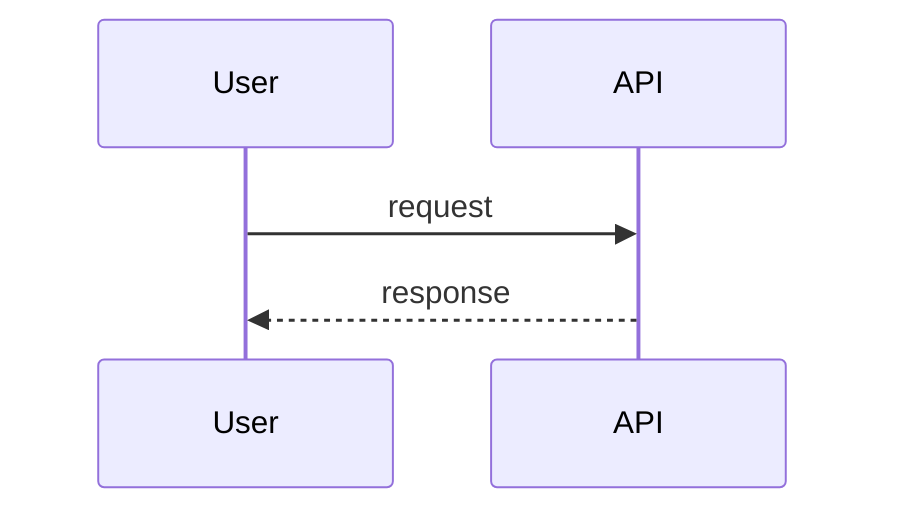

# Design Doc – <System name>

**Version:** v0 | v1 · **Authors:** <names> · **Reviewer:** <mentor> · **Last updated:** <dd/mm/yyyy>

## 1. Summary

<The solution in five sentences.>

## 2. Goals / Non-goals

## 3. Architecture overview

<Component diagram (Mermaid is rendered by GitHub) and the responsibility of each component.>

## 4. Main flows

<Sequence diagram for 1–2 critical flows.>

## 5. API

| Method | Path | Request | Response | Errors |
|---|---|---|---|---|

## 6. Data model

<Schema / ERD, data lifecycle.>

## 7. Alternatives considered

<At least two alternatives and why they were rejected.>

## 8. Testing and evaluation

<How we prove the system meets each FR / NFR.>

## 9. Operations

<Logging, monitoring, configuration, deployment.>

## 10. Security and privacy

## 11. Risks and open questions
