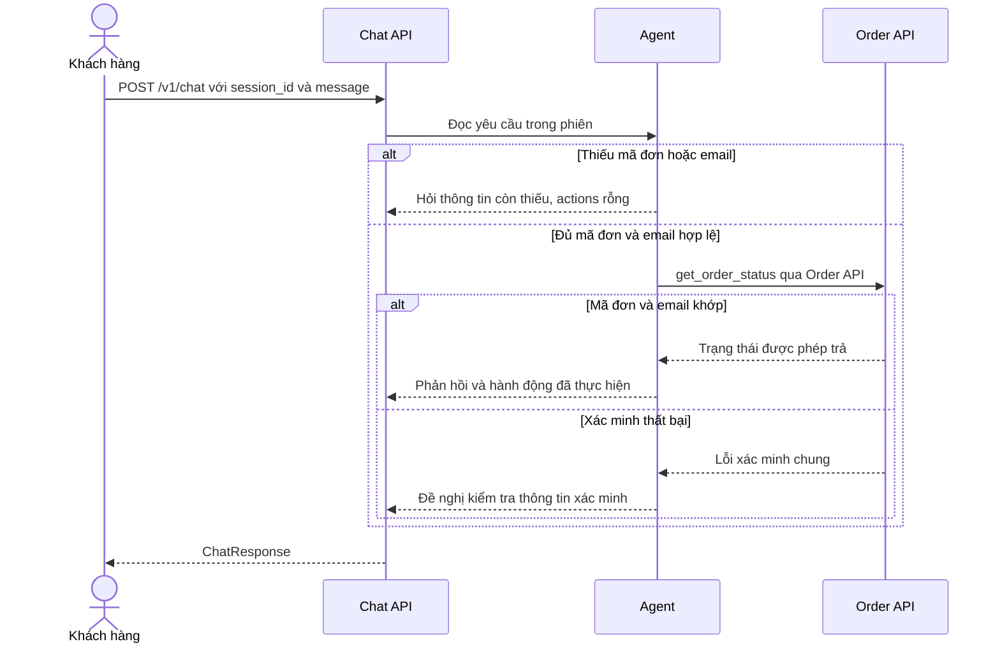

# Sprint 1 — Kế hoạch công việc Customer Support Agent

**Dự án** · ShopX, nhóm AIE-01
**Giai đoạn** · Discovery & Design, một tuần từ thứ Hai đến thứ Sáu
**Mentor** · Nguyễn Trần Anh Quân

**Sprint Goal.** Thống nhất PRD v1.0 và Design Doc v0, hoàn thiện kho ít nhất 20 tài liệu chính sách ShopX và bộ đánh giá v0 gồm 30 câu có nhãn.

**Trần Minh Khôi** là **AI Engineer kiêm Scrum Master Sprint 1**. Khôi chủ trì ingestion, retrieval, prompt, vòng lặp gọi tool, guardrail và đánh giá. **Nguyễn Quốc Trọng** là **Backend & Platform Engineer**. Trọng chủ trì Chat API, Order API và dữ liệu giả, Ticket Service, giao diện, tracing, Docker và CI. Hai người cùng soạn KB, viết nhãn eval và review PR của nhau. Khôi giữ nhịp board, ghi quyết định, điều phối Planning và Review, rồi nộp `WSR-S1.md`.

Phân công ban đầu phù hợp với mục 5.1–5.2 của đặc tả. Để đủ đầu ra Sprint 1 ở mục 7–8, kế hoạch bổ sung **fixture 100 đơn, notebook RAG trên 10 câu, quyết định LLM của mentor, kiểm tra quy trình PR/CI và backlog Sprint 2**. Kế hoạch cũng giao rõ phần FR-07 và phần xử lý bàn giao giữa agent với backend. Ngày sprint, số issue và người có quyền cấu hình branch protection được xác nhận trong Planning.

## 1. Công việc đưa lên board

| Đầu việc | Chủ trì và phối hợp | Bằng chứng hoàn thành |
| --- | --- | --- |
| PRD v1.0 | **Khôi** tổng hợp, **Trọng** viết phần Backend | `docs/PRD.md` đủ 9 mục của Phụ lục A.2, kèm 10 intent, luồng và tiêu chí chấp nhận. PR có mentor duyệt. |
| Design Doc v0 | **Trọng** tổng hợp, **Khôi** viết RAG, prompt và eval | `docs/DESIGN.md` đủ 11 mục của Phụ lục A.3, có sequence một lượt gọi tool, API contract và data model. PR có mentor duyệt. |
| Kho tài liệu | **Khôi** 10 file, **Trọng** 10 file | Tối thiểu 20 policy ShopX đã review và merge vào `main`. Hai người đối chiếu các điều kiện có liên quan giữa các mảng. |
| Fixture 100 đơn | **Trọng**, bàn giao cho **Khôi** | Script sinh lại được 100 đơn giả, ghi lệnh và các đơn dùng để tạo nhãn eval. |
| Bộ đánh giá v0 | **Khôi** gom file, mỗi người viết 12 câu mới và cùng duyệt 6 câu seed | `eval/datasets/v0/cases.jsonl` đủ 30 case hợp lệ, nguồn và nhãn khớp policy, fixture và contract, đã merge vào `main`. |
| Quyết định LLM và notebook RAG | **Khôi**, **Trọng** review cách chạy | Mentor chốt API hoặc Ollama, có ADR. Notebook có kết quả trả lời 10 câu, nguồn truy xuất, cấu hình và ghi nhận lỗi. |
| Quy trình PR và CI | **Trọng**, **Khôi** đối chiếu DoD khi review | PR template có sẵn, xác nhận quy tắc bảo vệ `main`, các job của CSA và link lần chạy xanh trên `main`. |
| Điều phối và WSR | **Khôi**, **Trọng** cung cấp số liệu và link | Board cập nhật, PR WSR và link trên kênh nhóm trước giờ nộp, backlog Sprint 2 có người phụ trách. |

Đặc tả dự kiến **8–10 giờ/người/tuần**, tính cả review. Khối lượng KB và số câu mới chia đều, còn Khôi có thêm notebook, tích hợp eval và Scrum Master. Trọng phụ trách lượt rà dữ liệu của phần eval đã gom (đếm case, rà ID/trường, kiểm tra `doc_id` và fixture). Khôi rà lần cuối nhãn hành vi. Hai người ước lượng lại ở Planning và tách issue theo S ≤ 2 giờ, M ≤ 5 giờ, L ≤ 1 ngày. Chốt sớm policy, fixture và model vì ba việc này chi phối eval và notebook. Nếu cần thay đổi phạm vi, ghi đề xuất và xin mentor chốt.

## 2. PRD v1.0

Dùng [mẫu PRD](../../docs/templates/PRD.md), bổ sung bảng intent và luồng handoff. Cả ba persona cần mục tiêu và khó khăn cụ thể. Mỗi user story có acceptance criteria theo Given / When / Then, nối tới FR. Mỗi FR/NFR có issue và test hoặc case kiểm chứng tương ứng. Các link chưa có được điền khi tạo issue và viết case.

| Phần | Khôi · AI Engineer | Trọng · Backend & Platform Engineer |
| --- | --- | --- |
| Persona và user stories | Khách hàng hỏi policy, tra đơn, cần hỗ trợ và hỏi tiếp trong phiên. | Nhân viên nhận ticket, đọc tóm tắt, cập nhật trạng thái. Quản lý cần theo dõi tỉ lệ tự giải quyết, chuyển người và chi phí. Ghi rõ nguồn số liệu trong phạm vi đã chốt. |
| 10 intent và luồng | Chủ trì cả 10 intent, RAG, guardrail, điều kiện hỏi thêm hoặc chuyển người. | Review các luồng liên quan Order API, ticket, session và admin. |
| FR mức Must | **FR-02, FR-03**. Với **FR-06**, xác định trigger và dữ liệu tóm tắt từ agent. | **FR-01, FR-04, FR-05, FR-06**. Với **FR-06**, chịu trách nhiệm tạo ticket ưu tiên cao, lưu trạng thái và trả mã ticket. |
| FR mức Should | Cùng thiết kế **FR-07**, xác định số lượt đưa vào ngữ cảnh và cách dùng thông tin đã được cung cấp. | Chủ trì **FR-07** về lưu và cách ly theo `session_id`, cùng **FR-08** về chat UI có trích dẫn và admin ticket. |
| FR mức Could | **FR-09**, trả lời theo ngôn ngữ khách nếu triển khai song ngữ. | **FR-10**, giao diện phản hồi và lưu feedback nếu triển khai. |
| NFR | Chủ trì **NFR-01–05**. Với **NFR-08**, cung cấp phiên bản prompt, model, tham số và bộ eval. | Chủ trì **NFR-06–08**. Với **NFR-03–04**, cung cấp bằng chứng từ Order API và Ticket Service. |

**10 intent đề xuất** gồm đổi trả/hoàn tiền, phí giao, thời gian giao, thanh toán, bảo hành, tài khoản, khuyến mãi, tra cứu đơn, tạo ticket và gặp nhân viên. Mỗi intent ghi câu mẫu, dữ liệu cần, nhánh xử lý, đầu ra, điều kiện lỗi và tiêu chí chấp nhận. Câu hỏi về quy định hủy đơn thuộc policy. Thao tác hủy đơn trên hệ thống nằm ngoài các tool đã xác định.

- Hỏi policy có nguồn → trả lời kèm `doc_id` và đoạn trích. Thiếu nguồn lần đầu → nói rõ, hỏi làm rõ khi phù hợp hoặc đề nghị gặp nhân viên. Hai lượt chưa giải quyết được → handoff theo FR-06.
- Gặp người thật, rất bức xúc hoặc yêu cầu hỗ trợ ngoài phạm vi → handoff theo FR-06. Ca chỉ yêu cầu tiết lộ hướng dẫn nội bộ → từ chối và đề nghị hỗ trợ về ShopX. Hai người review các ca giao nhau trước khi khóa nhãn để quy tắc trong PRD, design và eval khớp nhau.
- Giữ phạm vi ShopX giả lập, xác minh bằng mã đơn + email. Ghi các non-goal từ PDF gồm tích hợp hệ thống thật, OAuth/OTP, giọng nói, fine-tune LLM và huấn luyện embedding.

### Chỉ số cần ghi trong PRD

Các ngưỡng dưới đây lấy từ mục 3.2 của đặc tả. Sprint 1 xác định cách đo và dữ liệu. Kết quả chính thức lấy ở các sprint đánh giá và phát hành.

| ID | Chỉ tiêu và cách đo |
| --- | --- |
| NFR-01 | Đúng ≥ 80% trên tập ≥ 60 câu. Chấm bằng LLM-as-judge, đối chiếu thủ công 20 mẫu. |
| NFR-02 | ≥ 90% câu trả lời policy có trích dẫn đúng tài liệu chứa thông tin. Đối chiếu `doc_id` và đoạn trích với nhãn. |
| NFR-03 | ≥ 90% ca cần tool gọi đúng tên **và** đúng tham số. Có **0** ca lộ thông tin đơn trước xác minh, kiểm tra bằng nhóm ca thiếu/sai dữ liệu xác minh. |
| NFR-04 | Handoff recall ≥ 90%. Báo cáo thêm precision và đối chiếu tín hiệu chuyển người với việc tạo ticket ưu tiên cao. |
| NFR-05 | Xử lý đúng ít nhất 8 ca trên bộ ≥ 10 kịch bản prompt injection và ngoài phạm vi. |
| NFR-06 | p95 ≤ 6 giây mỗi lượt trên 50 lượt, bỏ lượt khởi động đầu. Đo từng lượt theo cấu hình benchmark đã ghi. |
| NFR-07 | Mỗi lượt có log token vào/ra, chi phí ước tính, độ trễ từng bước, tool và các đoạn được truy xuất. Tổng chi phí API trong ngân sách mentor cấp. |
| NFR-08 | Prompt có version, model và tham số qua cấu hình, eval một lệnh có báo cáo. Gắn commit, phiên bản prompt và dataset vào kết quả. |

## 3. Design Doc v0

Dùng [mẫu Design Doc](../../docs/templates/DESIGN.md). **Trọng** chủ trì tóm tắt, kiến trúc, sequence, API, data model, vận hành và bảo mật. **Khôi** viết ingestion/retrieval, prompt, tool loop, guardrail và kiểm thử/eval. Cùng ghi mục tiêu và non-goal, ít nhất hai phương án đã cân nhắc cùng lý do chọn/loại, rủi ro và câu hỏi còn mở. Các quyết định chưa có mentor duyệt được đánh dấu đang đề xuất.

### Kiến trúc và API cần chốt

- Sơ đồ ghi hướng dữ liệu giữa Chat UI, Chat API, orchestrator, LLM, retriever/index, Order API, Ticket Service, admin và tracing/eval. Data model mô tả `Order`, `Ticket`, `Session`/`Message` và `Chunk`, nơi lưu, dòng đời và dữ liệu cần tránh đưa vào log. Ghi rõ storage trong scaffold và phương án dự kiến để nhóm review.
- `POST /v1/chat` nhận `session_id`, `message`. Kết quả có `session_id`, `answer`, `citations` (`doc_id`, `snippet`, `score` tùy chọn), `actions`, `handoff`, `ticket_id` và `trace_id`. Bổ sung request/response mẫu, mã lỗi đầu vào và lỗi phụ thuộc, cùng cách làm sạch thông tin nhạy cảm trong `actions` và log. [Schema Chat API](../support_agent/schemas.py)
- Order API giả lập có `GET /v1/orders/{order_id}` với `email` theo contract hiện có. Nhánh mã không tồn tại và email sai trả lỗi xác minh chung theo thiết kế. Theo dõi cách loại email khỏi access log, trace và dữ liệu trả công khai. Kiểm tra `/health` riêng với kiểm tra hành vi tra đơn. [Order API](../services/order_api/main.py)
- Khôi mô tả pipeline Markdown/PDF → chia đoạn → embedding → index → retrieval → trích dẫn. Giữ `doc_id` theo tên file và `chunk_id` để truy vết, quy định cách cập nhật index khi tài liệu đổi/xóa, dùng ngưỡng nguồn và giới hạn top-k từ cấu hình. Ghi rõ hỗ trợ PDF, embedding và index là phần sẽ hoàn thiện theo FR-02. Bản scaffold đang đọc Markdown và chia đoạn theo số ký tự. [Ingestion hiện tại](../support_agent/retrieval/ingest.py) · [Cấu hình](../configs/agent.yaml)

### Tool signature và trách nhiệm hai phía

| Tool | Quy tắc đưa vào thiết kế |
| --- | --- |
| `get_order_status(order_id, email)` | Khôi kiểm tra đủ trường và tham số đúng định dạng trước khi gọi. Trọng xác minh cặp mã đơn và email ở Order API trước khi trả trạng thái. Sai email hoặc sai mã trả kết quả chung, không kèm dữ liệu đơn. |
| `create_ticket(category, summary, priority)` | Khôi tạo tham số đúng schema. Trọng lưu ticket và trả `ticket_id` khi lưu thành công. Dùng cho yêu cầu tạo ticket thông thường. |
| `handoff_to_human(reason, conversation_summary)` | Tool nội bộ có trong registry, dùng cho ca FR-06. Khôi xác định trigger, reason và tóm tắt. Trọng tái sử dụng cơ chế lưu ticket với priority `high`, cập nhật trạng thái phiên theo thiết kế và trả `ticket_id`. Chỉ xác nhận đã chuyển người khi tạo ticket thành công. Nhánh lỗi cần phản hồi an toàn và tránh tạo trùng khi retry. |

Đặc tả nêu hai tool nghiệp vụ tra đơn và tạo ticket. Scaffold khai báo thêm `handoff_to_human` để điều phối hành vi chuyển người dùng chung Ticket Service. `hof-001` đang gắn với tên tool này. Các hàm xử lý nghiệp vụ trong [tool tra đơn](../support_agent/tools/order_status.py) và [tool ticket/handoff](../support_agent/tools/ticket.py) đang là stub.

### Sequence tra đơn cần đưa vào Design Doc



Kiểm tra ba nhánh với case riêng. Ca `ord-002` chỉ có mã đơn phải hỏi email, `expected_tool: null`. Ca có email đúng định dạng nhưng sai với đơn cần chứng minh Order API từ chối và agent không lộ trạng thái. Ca đủ và khớp phải đối chiếu trạng thái với fixture.

## 4. KB và fixture đơn hàng

Đặt tài liệu trực tiếp dưới `kb/`, theo quy ước hiện tại. Tên file bỏ `.md` là `doc_id`, dùng kebab-case và duy nhất trong toàn KB. Mỗi file có một chủ đề, tiêu đề `#`, dòng `Last updated` và mục `##`. Dùng phí, số ngày, hạn mức và ngoại lệ cụ thể. Tài liệu là policy tự soạn cho ShopX. Phối hợp nguồn và câu hỏi tiếng Việt/Anh theo phạm vi FR-09 đã chốt. [Quy ước KB](../kb/README.md)

| Chủ trì | Mảng | Số file | File đề xuất |
| --- | --- | ---: | --- |
| Trọng | Shipping | 4 | `shipping-policy.md`, `shipping-areas-and-fees.md`, `international-shipping.md`, `order-tracking-and-delivery-issues.md` |
| Trọng | Payment | 3 | `payment-methods.md`, `cod-policy.md`, `installment-payment.md` |
| Trọng | Account | 3 | `account-registration.md`, `password-reset.md`, `privacy-policy.md` |
| Khôi | Returns | 4 | `return-policy.md`, `refund-process.md`, `non-returnable-items.md`, `order-cancellation-policy.md` |
| Khôi | Warranty | 3 | `warranty-policy.md`, `warranty-claim-process.md`, `warranty-exclusions.md` |
| Khôi | Promotions | 3 | `voucher-rules.md`, `loyalty-program.md`, `flash-sale-and-combo-rules.md` |

`shipping-policy.md` đang là tài liệu mẫu và là nguồn của `pol-001`, `pol-002`. Trọng review nội dung, cập nhật dòng ngày, bỏ ghi chú mẫu khi hoàn thiện và tính vào 10 file của mình. Nếu chuyển chi tiết sang file khác hoặc sửa số liệu, cập nhật nhãn và nguồn eval trong cùng đợt review. Hai người chốt một nguồn chính cho mỗi quy tắc giao hàng/miễn phí, mã ưu đãi, đổi trả/bảo hành và hoàn tiền. Chỉ tính file đã review vào mốc 20.

**Fixture** do Trọng tái tạo. Lệnh dưới đây chạy từ `customer-support-agent/`.

```powershell
python scripts/generate_orders.py --n 100 --seed 42 --today 2026-11-30 --out var/orders.json
```

Script ghi đè `--out` nếu file đã có. Có thể trỏ `--out` đến file tạm để đối chiếu. `--today` ở đây là ngày tham chiếu cố định của fixture. Kiểm tra 100 mã duy nhất, email `@example.com` và trạng thái thuộc danh sách của script. Gửi Khôi cấu hình và các bản ghi dùng trong eval. Với cấu hình trên, `SX-000001` khớp `customer001@example.com` và có trạng thái `confirmed`. [Script sinh đơn](../scripts/generate_orders.py)

## 5. Bộ đánh giá v0 và notebook RAG

### `cases.jsonl` · 30 câu

Repo đang có **6 seed trong chính `cases.jsonl`**, gồm `pol-001`, `pol-002`, `ord-001`, `ord-002`, `hof-001`, `atk-001`. Hai người rà lại nhãn của 6 seed rồi thêm **12 + 12** vào cùng dataset. Khôi gom file sau khi Trọng review phần tham số tool và fixture. Nếu thay hẳn seed, giữ tổng 30 và cập nhật ID/tham chiếu liên quan. Với dataset đã dùng để công bố báo cáo, áp dụng quy tắc lưu version trong [README tập đánh giá](../eval/datasets/README.md). [File v0](../eval/datasets/v0/cases.jsonl)

| Người | 12 câu mới đề xuất | Ca cần phủ |
| --- | --- | --- |
| Khôi | 8 policy + 4 kiểm thử an toàn | Returns, Warranty, Promotions, câu có nguồn và câu thiếu nguồn. Kiểm tra từ chối tiết lộ hướng dẫn nội bộ, ngăn gọi tool ngoài ý định hỗ trợ và phản hồi phù hợp khi gặp chỉ dẫn bất thường. |
| Trọng | 5 order + 4 handoff + 3 policy | Đủ và khớp mã/email, thiếu thông tin, sai xác minh, hội thoại bổ sung trường ở lượt sau. Handoff theo từng trigger FR-06. Policy thuộc Shipping, Payment, Account. |

Mỗi dòng có đúng **8 trường** theo file v0 và runner: `id`, `category`, `turns`, `expected_answer`, `expected_doc_ids`, `expected_tool`, `expected_tool_args`, `must_handoff`. Dùng ID duy nhất theo `pol-`, `ord-`, `hof-`, `atk-`; giữ các category `policy`, `order`, `handoff`, `attack` cho cách chia v0. `turns` là mảng chuỗi không rỗng. Với ca nhiều lượt, ghi rõ nhánh nào được kiểm chứng ở lượt cuối. `expected_doc_ids` là danh sách, dùng `[]` khi không cần nguồn. Khi không gọi tool, cả `expected_tool` và `expected_tool_args` là `null`. `must_handoff` là boolean.

- Ca order hợp lệ hoặc ca đủ dữ liệu nhưng email sai ghi tên tool và tham số cụ thể. Ca thiếu email ghi `expected_tool: null` và đáp án kỳ vọng là hỏi email trước khi tra.
- Handoff cần `expected_tool: "handoff_to_human"` và `must_handoff: true`. Seed `hof-001` dùng `expected_tool_args: null`. Với lý do và tóm tắt do agent sinh, kiểm tra hai tham số theo schema và nghĩa, đồng thời xác nhận ticket ưu tiên cao và phản hồi có mã ticket sau khi tạo thành công.
- Khi duyệt v0, kiểm tra đúng 30 dòng có dữ liệu, JSON hợp lệ, đủ trường/kiểu, ID duy nhất, các `doc_id` tồn tại và đáp án khớp policy/fixture. Đối chiếu nhãn hành vi với PRD và Design, ghi kết quả review trong PR.

Để chạy thử harness hiện tại, dùng `python eval/run_eval.py --dataset eval/datasets/v0 --in-process --limit 20` từ `customer-support-agent/` với môi trường dev đã cài. `--dataset` nhận **thư mục**. `make eval-ci` chạy cùng đường dẫn v0 với mock. Runner hiện chấm theo phản hồi **lượt cuối**, kiểm tra giao của `doc_id`, tên tool nếu nhãn có tool, và cờ handoff. Các phần đối chiếu tham số, khẳng định không gọi tool, chấm bằng LLM, recall/precision handoff và đo p95 trên 50 lượt cần bổ sung theo các issue Sprint 2–3. Báo cáo mock là bằng chứng chạy thử luồng harness. [Runner hiện tại](../eval/run_eval.py) · [Makefile](../Makefile)

### Notebook RAG · 10 câu phát triển riêng

Khôi lưu notebook ở `notebooks/rag_spike_s1.ipynb` hoặc đường dẫn đã chốt trên board. Chọn 10 câu phát triển riêng, gồm ca tìm được nguồn và ca thiếu nguồn. Ghi câu hỏi, nguồn kỳ vọng, đoạn truy xuất, câu trả lời và nhận xét. Phân loại lỗi tìm sai nguồn, trả lời sai với nguồn đúng, hoặc thiếu nguồn. Ghi provider/model, embedding, cách chia đoạn, top-k, phiên bản KB và lệnh chạy. Dùng bộ v0 để đánh giá, giữ ví dụ chỉnh prompt/few-shot ở tập phát triển.

Khôi gửi mentor phương án **API được cấp** và **Ollama** ngay đầu tuần, kèm model dự kiến, khả năng dùng tiếng Việt và tool calling, tài nguyên, ngân sách hoặc hạn mức. Repo đã có ADR-0001 về quy trình ADR. Ghi lựa chọn LLM ở `docs/adr/0002-llm-provider.md` theo [mẫu ADR](../../docs/templates/ADR.md), cập nhật theo quyết định thực tế. Nếu còn chờ model, Khôi chuẩn bị phần retrieval và ghi trách nhiệm xử lý trong WSR. Chỉ đánh dấu notebook hoàn tất khi đã ghi câu trả lời cho đủ 10 câu và lỗi quan sát. [ADR-0001](adr/0001-record-architecture-decisions.md)

## 6. Nhịp sprint và điều kiện hoàn thành

| Mốc | Việc thực hiện |
| --- | --- |
| Thứ Hai | Khôi điều phối Planning 30 phút. Gắn owner, ước lượng, FR/NFR và tiêu chí kiểm tra cho issue. Chốt fixture, quy tắc KB giao nhau và gửi lựa chọn LLM cho mentor. |
| Thứ Ba–Tư | Mở PR PRD/Design sớm cho mentor. Soạn KB và nhãn song song. Trọng kiểm tra PR template, branch protection và các job của [CSA CI](../../.github/workflows/csa-ci.yml). |
| Thứ Năm | Review chéo policy và nhãn, chạy notebook và kiểm tra dataset. Chốt demo và các issue Sprint 2. |
| Thứ Sáu trước 12:00 | Khôi mở PR `docs/reports/WSR-S1.md` và gửi link lên kênh nhóm trước Sprint Review. Nếu có nguy cơ trễ, báo mentor trước ít nhất 24 giờ, nêu lý do và hạn mới. |
| Thứ Sáu sau khi nộp | Review 30 phút với mentor, demo notebook và ghi quyết định. Retro 15 phút, bổ sung một việc nên giữ, một việc cần sửa và một hành động vào WSR. |

Standup async ít nhất thứ Hai, Tư và Sáu theo PDF, cập nhật `Đã làm / Sẽ làm / Vướng mắc`. Board đi từ `Backlog → To do → In progress → In review → Done`. Mỗi người tối thiểu **2 PR được merge và 2 lượt review có nhận xét thực chất**. Chia PR theo PRD, Design, policy của từng người, eval/fixture/notebook và WSR để dễ review. Merge qua PR đã approve, CI xanh, có bằng chứng acceptance criteria và dùng squash. Reviewer phản hồi trong 24 giờ. [Quy trình repo](../../CONTRIBUTING.md) · [PR template](../../.github/pull_request_template.md)

WSR theo [mẫu 10 mục](../../docs/templates/WSR.md), tối đa 2 trang. Điền TL;DR, sprint goal và kết quả, tiến độ issue/PR, số liệu, demo, ADR, rủi ro, retro, kế hoạch sprint tới và phần cần mentor hỗ trợ. Dùng Green/Amber/Red theo tình hình thực tế. Ghi link và số liệu quan sát được, kèm số giờ của mỗi người. Các mục chưa đo ghi `chưa đo`.

- [ ] PRD v1.0 và Design Doc v0 có link PR được mentor approve.
- [ ] Mentor chốt LLM, có quyết định trong ADR và đường dẫn tới bằng chứng review.
- [ ] KB có ít nhất 20 policy đã review và merge vào `main`.
- [ ] Script tái tạo được 100 đơn giả theo fixture đã chốt.
- [ ] Dataset v0 có đúng 30 case, được review và merge vào `main`.
- [ ] Notebook RAG trả lời 10 câu phát triển riêng, ghi nguồn và lỗi quan sát được.
- [ ] Có bằng chứng bảo vệ `main` và link CSA CI xanh trên `main`. Workflow hiện đã có lint, unit test + coverage, eval mock, Docker build và smoke `/health`.
- [ ] WSR-S1 có PR và link gửi trước hạn, sau Review cập nhật quyết định và retro.
- [ ] Backlog Sprint 2 sẵn sàng. Khôi chủ trì luồng RAG có nguồn, eval qua API và mock rút gọn 10 câu. Trọng chủ trì Chat API/Docker, Order API có xác minh và tracing. Cùng hoàn tất ít nhất ba ADR kỹ thuật theo Sprint 2. Ticket, handoff, bộ nhớ nhiều lượt, guardrail đầy đủ và UI nằm trong mốc triển khai Sprint 3.

**Căn cứ đối chiếu** · Customer Support Agent Requirement Specification v1.0 ngày 14/11/2026 (mục 3–9 và Phụ lục A.1–A.4), ghi chú `tongquat.docx`, kế hoạch Sprint 1 và mã nguồn hiện tại của `customer-support-agent/`.
