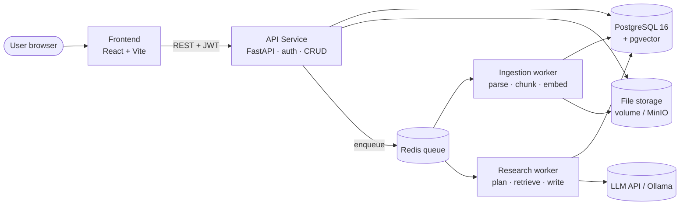

# Enterprise Research Agent

> Internal-document research platform: users upload documents into collections, ask a research
> question, follow the job's progress live, and receive a structured Markdown report whose every
> claim is cited back to the exact document and page.

| | |
|---|---|
| **Team code** | SE-AI-02 · Software Engineering + AI Engineering track |
| **Members** | Nguyễn Gia Huy · Nguyễn Hoàng Nhân · Nguyễn Huỳnh Gia Bảo · Huỳnh Nguyễn Huy Hoàng |
| **Mentor** | Trần Phan Đăng Khôi |
| **Timeline** | 4 sprints × 1 week · spec v1.0 (14/11/2026) |
| **Status** | 🚧 Sprint 0 – scaffold |

## Highlights

- **Multi-service architecture**: React frontend, FastAPI API, background workers, PostgreSQL + pgvector, Redis
- **Async job processing** with a durable queue, retries, idempotent ingestion and persisted progress
- **Agentic research pipeline**: plan sub-questions → retrieve → extract → write → verify citations
- **Security by default**: bcrypt passwords, expiring JWTs, per-user data isolation tested on every endpoint
- **Contract-first API**: OpenAPI spec committed and checked for drift in CI
- **Testing pyramid**: unit + integration (real Postgres in CI) + Playwright E2E + Locust load tests
- **Observability**: JSON logs with `request_id` / `job_id` across API and workers

## Architecture



Synchronous path (user ↔ API) answers in ≤ 300 ms p95; long work runs on workers. Job state lives in
PostgreSQL so restarting a worker never loses a job.

## Repository structure

```text
enterprise-research-agent/
├── backend/
│   ├── app/
│   │   ├── api/v1/          # auth, collections, documents, research routers
│   │   ├── core/            # config, security (bcrypt + JWT), JSON logging
│   │   ├── db/              # engine + session dependency
│   │   ├── models/          # SQLAlchemy models (users, collections, documents, chunks, jobs)
│   │   └── schemas/         # Pydantic request/response models
│   ├── workers/
│   │   ├── ingestion/       # parse → chunk → embed → index
│   │   ├── research/        # pipeline steps + runner with progress callbacks
│   │   └── queue.py         # RQ queues with retry
│   ├── migrations/          # Alembic
│   ├── scripts/             # export_openapi.py
│   └── tests/               # unit/, integration/
├── frontend/                # React + TypeScript (Vite), ESLint, Vitest
├── e2e/                     # Playwright
├── eval/                    # datasets/, run_eval.py, reports/
├── docs/                    # PRD, DESIGN, adr/, api/openapi.yaml, reports/
├── docker-compose.yml
├── Makefile
└── .env.example
```

## Getting started

```bash
cd enterprise-research-agent
cp .env.example .env

# Option 1 – everything in Docker
make up             # frontend :5173 · API :8000/docs · Postgres :5432 · Redis :6379

# Option 2 – infra in Docker, code locally (hot reload)
make infra          # postgres + redis
python -m venv .venv && source .venv/bin/activate
make install
make api            # terminal 1
make worker         # terminal 2
make web            # terminal 3
```

Quality gates:

```bash
make lint           # ruff + eslint + tsc
make test           # pytest (unit) + vitest
make openapi        # regenerate the API contract after changing endpoints, then commit it
```

## Requirements traceability

| ID | Requirement | Priority | Where | Status |
|---|---|---|---|---|
| FR-01 | Register / login, expiring JWT, all APIs protected | Must | `core/security.py`, `api/deps.py`, `api/v1/auth.py` | 🟨 security + guard done |
| FR-02 | Upload PDF/DOCX/MD ≤ 20 MB, async ingestion, per-doc status | Must | `api/v1/documents.py`, `workers/ingestion` | 🟨 contract ready |
| FR-03 | `POST /v1/research` → job_id, runs on worker | Must | `api/v1/research.py`, `workers/research` | 🟨 contract ready |
| FR-04 | `GET /v1/research/{id}` status + steps, UI progress | Must | `pipeline.run_pipeline` | 🟨 runner done |
| FR-05 | Plan → retrieve → cited Markdown report | Must | `workers/research/pipeline.py` | ⬜ |
| FR-06 | Web UI: docs, collections, ask, progress, report, open citation | Must | `frontend/` | 🟨 skeleton |
| FR-07 | Users only see their own data | Must | all routers | ⬜ |
| FR-08 | Research history + search | Should | `GET /v1/research?q=` | ⬜ |
| FR-09 | Export Markdown / PDF | Should | — | ⬜ |
| FR-10 | Cancel / retry jobs | Should | `/cancel`, `/retry` | 🟨 contract ready |
| FR-11 | Optional web-search tool | Could | — | ⬜ |
| FR-12 | Report feedback | Could | — | ⬜ |

| NFR | Target |
|---|---|
| NFR-01 Citation accuracy | ≥ 90% of ≥ 50 sampled citations support their claim (manual check) |
| NFR-02 Report quality | ≥ 70% key-point coverage on 30 questions (LLM-as-judge, 10 checked manually) |
| NFR-03 Performance | job p95 ≤ 3 min · sync API p95 ≤ 300 ms · 100-page PDF ≤ 2 min |
| NFR-04 Reliability | ≤ 2 retries · no job lost on worker restart · idempotent upload |
| NFR-05 Security | bcrypt/argon2 · expiring JWT · authz tests on every endpoint · file type/size limits |
| NFR-06 Observability | JSON logs with request_id + job_id · jobs by status · step durations · error rate |
| NFR-07 Maintainability | OpenAPI committed + checked in CI · backend coverage ≥ 70% · FE lint + type check |
| NFR-08 Deployment | `docker compose up` starts frontend, API, worker, Postgres (pgvector), Redis |

## Sprint plan

| Sprint | Theme | Key outputs |
|---|---|---|
| 1 | Discovery & Design | PRD, Design Doc v0, corpus chosen, 30-question eval set, ADRs (queue, LLM) |
| 2 | Walking Skeleton | auth + upload + ingestion + one research job end-to-end in Docker, Design Doc v1 |
| 3 | Feature Complete & Evaluation | full pipeline, UI, history, cancel/retry, E2E, load test, Test Plan, Eval Report |
| 4 | Hardening & Release | coverage ≥ 70%, perf fixes, `era-v1.0.0`, Runbook, Postmortem |

## Licenses

| Component | License |
|---|---|
| This code | MIT |
| Corpus documents | Per document — see `eval/datasets/corpus_manifest.csv` |
| pgvector | PostgreSQL License |
| LLM / embedding model | Fill in per ADR |
