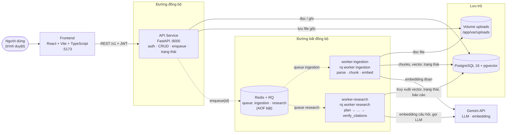
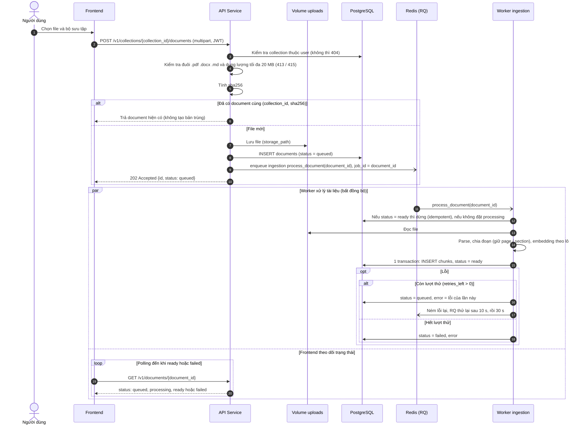
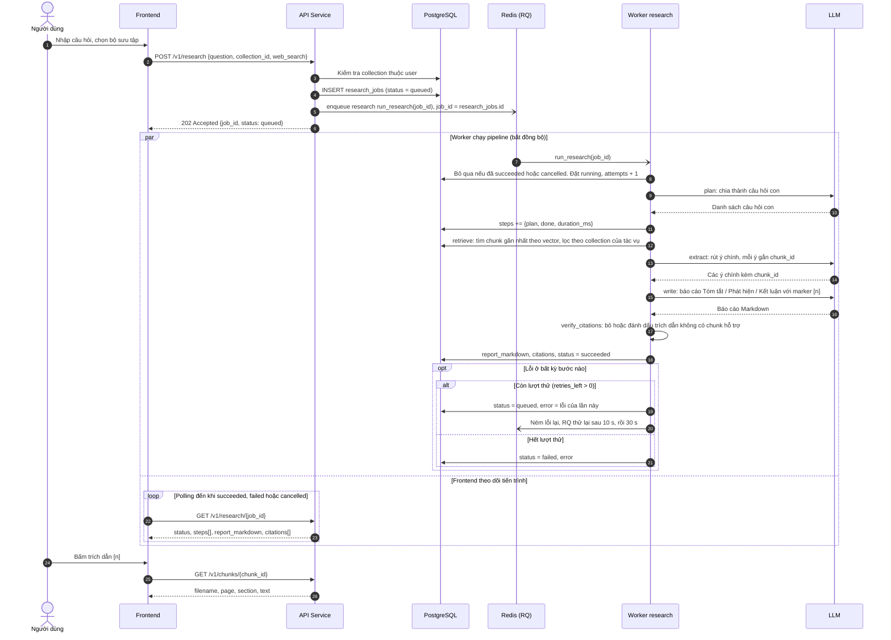
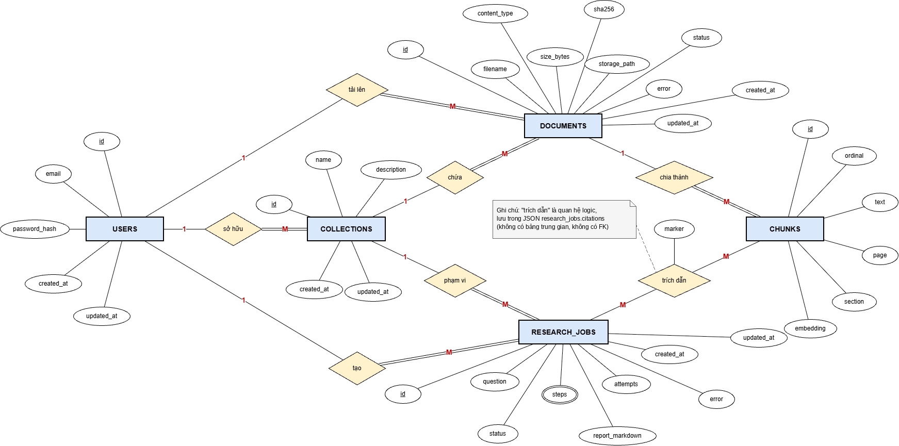

# Design Doc – Enterprise Research Agent

**Version:** v0 (Sprint 1 – Discovery & Design) · **Authors:** Nguyễn Huỳnh Gia Bảo · **Reviewer:** Trần Phan Đăng Khôi · **Last updated:** 23/11/2026

## 1. Tóm tắt

1. Hệ thống là một ứng dụng web. Người dùng tải tài liệu PDF/DOCX/Markdown vào bộ sưu tập, gửi câu hỏi nghiên cứu và nhận báo cáo Markdown có trích dẫn tới tài liệu và trang/mục.
2. **Đường đồng bộ** (Frontend ↔ API) chỉ làm việc nhanh: xác thực, ghi dữ liệu, đưa tác vụ vào hàng đợi, trả trạng thái.
3. **Đường bất đồng bộ** (Redis + RQ → hai worker: `worker-ingestion` xử lý tài liệu, `worker-research` chạy research pipeline) làm việc chạy lâu.
4. **PostgreSQL + pgvector là nơi lưu trạng thái chính thức** của tài liệu và tác vụ. Hàng đợi chỉ chở `id`, nên worker luôn đọc lại dữ liệu từ cơ sở dữ liệu.
5. Research pipeline gồm 5 bước `plan → retrieve → extract → write → verify_citations`. Mỗi bước được ghi lại vào tác vụ để giao diện hiển thị tiến trình. LLM nằm sau cấu hình `LLM_PROVIDER` (`mock` | `openai` | `ollama` | `gemini`), nên test và CI chạy được với bản giả lập.

## 2. Mục tiêu và ngoài mục tiêu

**Mục tiêu của thiết kế v0:**
- Đủ để triển khai các FR Must (FR-01 → FR-07) trong Sprint 2–3 mà không phải đổi kiến trúc.
- API đồng bộ không bao giờ chờ LLM hay xử lý tài liệu (NFR-03: p95 ≤ 300 ms).
- Tác vụ không mất khi worker khởi động lại, thử lại tối đa 2 lần, tải lại cùng file không tạo bản trùng (NFR-04).
- Người dùng chỉ thấy dữ liệu của mình (FR-07).

**Ngoài mục tiêu:** theo PRD Mục 7. Không SSO, không multi-tenant, không kết nối nguồn dữ liệu doanh nghiệp thật, không fine-tune, không triển khai cloud có tính sẵn sàng cao.

## 3. Kiến trúc tổng thể

### 3.1 System Architecture Diagram



Ghi chú:
- **Mũi tên nét liền** là lời gọi đồng bộ, chiều mũi tên là chiều gọi (bên gọi chờ kết quả, phản hồi không vẽ). **Mũi tên nét đứt** là chuyển việc bất đồng bộ qua hàng đợi: API không chờ worker. Mục 4 dùng cùng quy ước này.
- **Hai service worker:** `worker-ingestion` chỉ nghe hàng đợi `ingestion`, `worker-research` chỉ nghe hàng đợi `research`. API và hai worker dùng chung một image backend, chỉ khác lệnh chạy. Nhờ tách ra, tài liệu mới tải lên không phải chờ một tác vụ nghiên cứu đang chạy (NFR-03).
- **Model embedding** là **Gemini Embedding 2** (`gemini-embedding-2`), gọi qua Gemini API bằng SDK `google-genai` trong `workers/embedding.py`. Vector được rút về 384 chiều bằng tham số `output_dimensionality`, khớp cột `vector(384)`. Worker gửi theo lô 32 đoạn, tự giới hạn 80 đoạn mỗi phút trong mỗi process và thử lại khi Gemini trả 429 (vượt hạn mức). Ingestion dùng nó để nhúng đoạn văn bản, research dùng để nhúng câu hỏi con. API không tạo embedding.
- API và worker **không gọi nhau qua HTTP**. Hai bên chỉ giao tiếp qua Redis và PostgreSQL.

### 3.2 Trách nhiệm từng component

| Component | Trách nhiệm | Không làm | Vị trí trong repo | Phụ trách |
|---|---|---|---|---|
| **Frontend** | Đăng nhập, quản lý bộ sưu tập và tài liệu, gửi câu hỏi, polling trạng thái, hiển thị báo cáo, mở đoạn nguồn khi bấm trích dẫn | Không giữ secret, không gọi LLM, chỉ gọi API `/v1` | `frontend/src/` (`pages/`, `api/client.ts`) | R4 |
| **API Service** | Xác thực JWT, kiểm tra quyền sở hữu, CRUD, nhận file (kiểm tra loại, dung lượng, sha256), lưu file, tạo bản ghi và enqueue, trả trạng thái và báo cáo, sinh OpenAPI, gắn `X-Request-ID` | Không parse tài liệu, không embedding, không gọi LLM | `backend/app/` (`api/v1/`, `core/`, `db/`, `models/`, `schemas/`) | R1 |
| **Queue (Redis + RQ)** | Chuyển `id` từ API sang worker. Retry tối đa 2 lần với khoảng chờ 10 s, 30 s. Timeout job 600 s. Dùng DB id làm RQ job id. Reconciler phục hồi job bị sót hoặc bị kẹt (Mục 4.5) | Không phải nơi lưu trạng thái chính thức | `backend/workers/queue.py`, ADR-0002 | R1 |
| **Worker – ingestion** (service `worker-ingestion`) | `process_document(document_id)`: parse (PDF theo trang, DOCX và Markdown theo tiêu đề) → chia đoạn → embedding theo lô → ghi `chunks` trong một transaction → `ready` hoặc `failed` | Không kiểm tra quyền (API đã kiểm tra) | `backend/workers/ingestion/tasks.py` | R2 |
| **Worker – research** (service `worker-research`) | `run_research(job_id)`: chạy 5 bước, ghi tiến trình vào `research_jobs.steps` sau mỗi bước, lưu `report_markdown` và `citations` | Chỉ truy xuất trong bộ sưu tập của tác vụ | `backend/workers/research/` (`tasks.py`, `pipeline.py`) | R3 |
| **PostgreSQL + pgvector** | Lưu users, collections, documents, chunks + vector, research_jobs | Không lưu file gốc | `backend/app/models/`, `backend/migrations/` | R1 (schema), R2 (vector) |
| **Volume uploads** | Lưu file gốc tại `storage_path` | Không public trực tiếp | volume `uploads` trong `docker-compose.yml` | R2 |
| **Logging** | Log JSON có `request_id` và `job_id` (contextvars), thời gian mỗi request và mỗi bước | Không log mật khẩu, token, nội dung tài liệu | `backend/app/core/logging.py` | R4 + mỗi role |

## 4. Luồng xử lý chính

### 4.1 Luồng tải và xử lý tài liệu (FR-02)



**Quy tắc retry (áp dụng cho cả 4.1 và 4.2):** worker chỉ ghi `failed` khi **đã hết lượt thử**. Nếu còn lượt (`rq.get_current_job().retries_left > 0`), worker đưa trạng thái về `queued`, lưu lỗi của lần đó vào `error`, rồi ném lỗi lại để RQ thử tiếp. Nhờ vậy:
- Frontend chỉ dừng polling khi tác vụ thật sự kết thúc (`ready`, `succeeded`, `failed` hoặc `cancelled`).
- `failed` luôn có nghĩa là "đã hết lượt tự thử lại", nên chạy lại thủ công ở FR-10 không chạy trùng với lượt retry của RQ.
- Không thêm trạng thái mới, giữ đúng các giá trị trong FR-02 và FR-04.

**API ghi DB trước, enqueue sau.** Nếu enqueue lỗi, API vẫn trả 202 và ghi log lỗi. Bản ghi đã nằm trong DB ở trạng thái `queued`, nên reconciler (Mục 4.5) sẽ enqueue lại.

### 4.2 Luồng nghiên cứu (FR-03, FR-04, FR-05)



Lỗi và retry theo quy tắc ở Mục 4.1. Các bước pipeline đã được định nghĩa trong `workers/research/pipeline.py`. Runner `run_pipeline` báo tiến trình theo dạng `(tên bước, trạng thái, duration_ms)` với trạng thái `running` / `done` / `cancelled`. Giữa các bước, runner kiểm tra `is_cancelled()`.

### 4.3 Luồng dữ liệu giữa các module

Bảng này là thỏa thuận giữa các module: **W** là module được phép ghi, **R** là chỉ đọc. Một bảng chỉ được ghi bởi module có đánh dấu W.

| Dữ liệu | API Service | Worker – ingestion | Worker – research |
|---|---|---|---|
| `users` | W (đăng ký) / R | – | – |
| `collections` | W / R | – | R |
| `documents` | W (tạo, xóa) / R | W (`status`, `error`) | R (lọc theo bộ sưu tập, lấy `filename` cho trích dẫn) |
| File gốc (volume uploads) | W (lưu) | R | – |
| `chunks` | R (`GET /v1/chunks/{id}`) | W | R (truy xuất vector) |
| `research_jobs` | W (tạo) / R | – | W (`status`, `attempts`, `steps`, `report_markdown`, `citations`, `error`) |

Frontend không truy cập trực tiếp bảng nào, mọi thứ đi qua API.

**API giao việc cho worker qua RQ.** RQ không gửi message JSON mà lưu **lời gọi hàm kèm tham số** vào Redis (`workers/queue.py`):

```python
enqueue("ingestion", process_document, str(document.id), job_id=str(document.id))
enqueue("research",  run_research,     str(job.id),      job_id=str(job.id))
```

- Tham số chỉ là `id`, worker tự đọc phần còn lại từ PostgreSQL và volume. RQ job id bằng DB id, nên enqueue lặp lại không tạo việc trùng.
- **Truyền `request_id` (NFR-06, Sprint 2):** API gửi kèm `request_id` qua `meta` của RQ, ví dụ `enqueue(..., meta={"request_id": request_id_var.get()})`. Khi bắt đầu job, worker đọc `get_current_job().meta["request_id"]` và gán vào `request_id_var`, cạnh `job_id_var` đang có. Mọi dòng log của worker vì vậy có đủ `request_id` và `job_id`. RQ giữ nguyên `meta` qua các lần retry, nên log của mọi lần thử đều nối về request ban đầu.

### 4.4 Trạng thái

| Đối tượng | Giá trị (enum trong code) | Ghi chú |
|---|---|---|
| `documents.status` | `queued` · `processing` · `ready` · `failed` | Đúng 4 giá trị của FR-02. `failed` chỉ ghi khi đã hết lượt thử (Mục 4.1) |
| `research_jobs.status` | `queued` · `running` · `succeeded` · `failed` · `cancelled` | 4 giá trị của FR-04, thêm `cancelled` cho FR-10 (mentor đã đồng ý, Q1). Hủy là bất đồng bộ: worker dừng ở ranh giới bước kế tiếp. `failed` chỉ ghi khi đã hết lượt thử |
| Trạng thái từng bước trong `steps` | `running` · `done` · `cancelled` | Do `run_pipeline` ghi |

### 4.5 Phục hồi job (reconciler, NFR-04)

Có hai tình huống làm job bị kẹt mà RQ không tự xử lý:
1. **Ghi DB và enqueue không cùng một transaction.** API đã commit bản ghi `queued` nhưng chết hoặc Redis lỗi trước khi enqueue, nên job không bao giờ tới worker.
2. **Worker chết giữa chừng.** Bản ghi kẹt ở `processing` (document) hoặc `running` (research job). Worker bỏ qua document đang `processing` để tránh hai worker xử lý trùng, nên enqueue lại thôi chưa đủ.

**Reconciler** là một hàm chạy khi worker khởi động và chạy định kỳ (đề xuất mỗi 5 phút; cách lập lịch chốt khi implement). Mỗi worker chỉ phục hồi bảng của mình: `worker-ingestion` xử lý `documents`, `worker-research` xử lý `research_jobs`.

| Bản ghi | Điều kiện | Xử lý |
|---|---|---|
| `queued` | Cũ hơn 5 phút và RQ không có job chờ hoặc đang chạy với id đó | Enqueue lại |
| `processing` / `running` | Không cập nhật quá `job_timeout` (600 s) | Đưa về `queued`, rồi enqueue lại |
| `ready` / `succeeded` / `failed` / `cancelled` | – | Không đụng tới |

- RQ job id bằng DB id, nên enqueue lại là idempotent: chạy reconciler nhiều lần không tạo việc trùng.
- Nhóm không dùng bảng outbox riêng. Bản ghi `queued` trong DB đã đóng vai "việc cần gửi", reconciler là phần đọc ra và gửi lại.
- Một research job bị kẹt lặp lại nhiều lần (ví dụ làm worker chết mỗi lần chạy) được đặt `failed` khi `attempts` vượt quá 3, để không lặp vô hạn.
- Làm ở **Sprint 2** (R1). Reconciler thay cho "reaper" dự kiến ở Sprint 3 trong ADR-0002.

NFR-04 được đáp ứng như sau: job đang chờ không mất nhờ Redis bật AOF và reconciler. Job đang chạy lúc worker khởi động lại được đưa về hàng đợi trong khoảng 600 s cộng một chu kỳ reconciler.

## 5. API (bản nháp)

Contract đầy đủ nằm ở [`api/openapi.yaml`](api/openapi.yaml). File này được sinh từ code bằng `make openapi`, và CI kiểm tra nó khớp với code.

| Method | Path | Request | Response | Lỗi | FR |
|---|---|---|---|---|---|
| GET | `/health` | – | `{status, version}` | – | NFR-08 |
| POST | `/v1/auth/register` | `{email, password (8–128)}` | 201 `{id, email}` | 409 email đã tồn tại, 422 | FR-01 |
| POST | `/v1/auth/login` | `{email, password}` | `{access_token, token_type, expires_in}` | 401 (cùng thông báo cho email sai và mật khẩu sai) | FR-01 |
| GET | `/v1/auth/me` | – | `{id, email}` | 401 | FR-01 |
| GET | `/v1/collections` | – | `[{id, name, description, document_count, created_at}]` | 401 | FR-06 |
| POST | `/v1/collections` | `{name, description?}` | 201 collection | 401, 422 | FR-06 |
| DELETE | `/v1/collections/{collection_id}` | – | 204 | 401, 404 | FR-06 |
| POST | `/v1/collections/{collection_id}/documents` | multipart `file` | 202 `{id, collection_id, filename, size_bytes, status, error, created_at}` | 401, 404, 413, 415 | FR-02 |
| GET | `/v1/collections/{collection_id}/documents` | – | `[document]` | 401, 404 | FR-02 |
| GET | `/v1/documents/{document_id}` | – | document | 401, 404 | FR-02 |
| GET | `/v1/chunks/{chunk_id}` | – | `{id, document_id, filename, page, section, text}` | 401, 404 | FR-06 |
| POST | `/v1/research` | `{question (10–2000), collection_id, web_search=false}` | 202 `{job_id, status}` | 401, 404, 422 | FR-03 |
| GET | `/v1/research/{job_id}` | – | `{job_id, question, status, steps[], report_markdown, citations[], error, created_at, updated_at}` | 401, 404 | FR-04, FR-05 |
| GET | `/v1/research?q=` | – | `[research]` | 401 | FR-08 (Should) |
| POST | `/v1/research/{job_id}/cancel` · `/retry` | – | research / 202 | 401, 404 | FR-10 (Should) |

**Quy ước:**
- Cột "Lỗi" là hành vi dự kiến, lấy từ ghi chú TODO trong router. `openapi.yaml` hiện mới khai báo 422 (validate tự động của FastAPI), các mã còn lại thêm vào khi implement ở Sprint 2.
- Mọi endpoint, trừ `/health`, `/v1/auth/register` và `/v1/auth/login`, yêu cầu `Authorization: Bearer <JWT>`. Thiếu token hoặc token sai trả 401.
- Dữ liệu của người khác trả **404 (không phải 403)**, để không lộ việc `id` đó có tồn tại.
- Mọi response có header `X-Request-ID`.

**Ví dụ một phần tử `citations`** (kiểu `CitationOut`): `{"marker": "[1]", "document_id": "77c1…", "chunk_id": "c9e0…", "filename": "NIST.SP.800-53r5.pdf", "page": 18, "section": "AC-2 Account Management"}`. Báo cáo chứa marker `[n]`. Frontend dùng danh sách `citations` để hiển thị trích dẫn dạng `[tên tài liệu, trang/mục]` như FR-05 yêu cầu, và để gọi `GET /v1/chunks/{chunk_id}` khi người dùng bấm vào.

## 6. Data model

### 6.1 Database ERD (phiên bản đầu tiên)



*Ghi chú:* quan hệ "trích dẫn" (M–M giữa RESEARCH_JOBS và CHUNKS) là quan hệ logic. Nó được lưu trong cột JSON `research_jobs.citations`, **không có bảng trung gian và không có khóa ngoại** (xem Mục 6.3).

Chi tiết cột (khớp `backend/app/models/`). Mọi bảng đều có `id` (uuid, khóa chính); bảng trừ `chunks` còn có `created_at`, `updated_at` (timestamptz).

| Thực thể | Khóa ngoại | Cột chính và ràng buộc |
|---|---|---|
| USERS | không | `email` (unique, ≤ 320), `password_hash` (bcrypt) |
| COLLECTIONS | `owner_id` → users | `name` (≤ 200), `description` (≤ 1000, null được) |
| DOCUMENTS | `owner_id` → users, `collection_id` → collections | `filename`, `content_type`, `size_bytes`, `sha256`, `storage_path`, `status` (queued/processing/ready/failed), `error`; unique `(collection_id, sha256)` |
| CHUNKS | `document_id` → documents | `ordinal`, `text`, `page` (null với DOCX/MD), `section`, `embedding` vector(384) |
| RESEARCH_JOBS | `owner_id` → users, `collection_id` → collections | `question`, `status` (queued/running/succeeded/failed/cancelled), `attempts`, `steps` JSON, `report_markdown`, `citations` JSON, `error` |

### 6.2 Quan hệ giữa các thực thể

| Quan hệ | Kiểu | Khi xóa thực thể cha | Ý nghĩa |
|---|---|---|---|
| USERS → COLLECTIONS | 1–N (`owner_id`) | CASCADE | Mỗi bộ sưu tập thuộc đúng một người dùng |
| USERS → DOCUMENTS | 1–N (`owner_id`) | CASCADE | `owner_id` lặp lại trên document để kiểm quyền không cần join |
| USERS → RESEARCH_JOBS | 1–N (`owner_id`) | CASCADE | Tác vụ và báo cáo thuộc người tạo |
| COLLECTIONS → DOCUMENTS | 1–N | CASCADE | Một tài liệu thuộc **đúng một** bộ sưu tập |
| COLLECTIONS → RESEARCH_JOBS | 1–N | CASCADE | Xóa bộ sưu tập thì xóa luôn tác vụ và báo cáo của nó |
| DOCUMENTS → CHUNKS | 1–N | CASCADE | Chunk là đơn vị truy xuất và trích dẫn, giữ `page` / `section` |
| RESEARCH_JOBS → CHUNKS | qua JSON `citations[].chunk_id` | không có FK | Trích dẫn trỏ tới chunk, nhưng không có ràng buộc trong DB (xem 6.3) |

**Kiểm tra quyền:** ba thực thể gốc (`collections`, `documents`, `research_jobs`) đều có `owner_id`. Truy vấn luôn lọc `owner_id = user hiện tại`. `chunks` không có `owner_id` nên được kiểm tra qua join tới `documents`. Truy xuất vector trong worker cũng join `documents` để lọc theo `collection_id` của tác vụ.

### 6.3 Lý do chọn mô hình đơn giản và hệ quả

Nhóm chọn lưu tiến trình (`steps`), báo cáo (`report_markdown`) và trích dẫn (`citations`) **ngay trong `research_jobs`**, dạng JSON và text, thay vì tách thành nhiều bảng.
- **Lợi:** ít bảng và migration. Mỗi tác vụ chỉ có một báo cáo nên không cần bảng riêng. `GET /v1/research/{job_id}` trả mọi thứ trong một lần đọc.
- **Hệ quả cần biết:**
  - Không có FK từ trích dẫn tới chunk. Nếu tài liệu bị xóa, `chunk_id` trong `citations` trỏ tới chunk không còn tồn tại, nên `GET /v1/chunks/{id}` trả 404.
  - Lấy mẫu trích dẫn cho NFR-01 phải đọc JSON (vẫn làm được bằng Python hoặc `jsonb_array_elements`).
  - Nếu sau này cần truy vấn nhiều trên trích dẫn hoặc bước, có thể tách bảng ở Design Doc v1 bằng một migration.

### 6.4 Vòng đời dữ liệu

- **Tải lại cùng file:** unique `(collection_id, sha256)` ngăn bản trùng. API trả document đã có.
- **Xử lý lại tài liệu:** worker bỏ qua nếu `status = ready`. Chunk được ghi trong một transaction, nên không có trạng thái nửa vời.
- **Xóa tài liệu hoặc bộ sưu tập:** CASCADE xóa chunk. Xóa bộ sưu tập còn xóa cả tác vụ nghiên cứu của nó.
- **Migration:** Alembic (`backend/migrations/`). Migration đầu tiên (Sprint 2) bật extension `vector` và tạo 5 bảng trên. Số chiều vector (384) phải khớp `EMBEDDING_DIM` và model embedding.

## 7. Phương án thay thế đã cân nhắc

| Phương án | Lý do không chọn |
|---|---|
| Chạy nghiên cứu **đồng bộ** trong request API | Request kéo dài tới 3 phút vượt timeout và không đạt p95 300 ms. Worker chết là mất tác vụ (NFR-04). |
| **Vector DB riêng** (Qdrant, Chroma) | Thêm một service phải vận hành. Mất transaction chung giữa `documents` và vector. Quy mô 50–100 tài liệu thì pgvector đủ. |
| **Celery hoặc arq** thay RQ | Đã so sánh trong [ADR-0002](adr/0002-job-queue.md): RQ đơn giản nhất cho nhóm trong 4 tuần. |
| **Tách nhiều bảng** cho bước, báo cáo, trích dẫn | Chặt chẽ hơn nhưng nhiều việc hơn. Chưa cần ở v0 (Mục 6.3). |
| **Một worker** cho cả hai hàng đợi | Tài liệu mới phải chờ khi một tác vụ nghiên cứu chạy khoảng 3 phút, ảnh hưởng trực tiếp NFR-03 (PDF 100 trang ≤ 2 phút; p95 tác vụ nghiên cứu tính cả thời gian chờ trong hàng đợi). Tách hai service gần như không tốn thêm: cùng image, mỗi service nghe một queue. |

## 8. Kiểm thử và đánh giá (mức Sprint 1)

Bảng dưới đây cho biết cách chứng minh từng yêu cầu. Test case chi tiết sẽ nằm trong Test Plan (Sprint 3). Test integration chạy với PostgreSQL và Redis thật trong CI, với `LLM_PROVIDER=mock`.

| Yêu cầu | Cách kiểm chứng | Loại | Đã có trong repo |
|---|---|---|---|
| FR-01 | Băm/kiểm mật khẩu, JWT hết hạn. Gọi API không token, token sai hoặc hết hạn trả 401 | unit + integration | `tests/unit/test_security.py` |
| FR-02 | Tải PDF/DOCX/MD và chờ tới `ready`. File lớn hơn 20 MB trả 413, sai loại trả 415 | integration | – |
| FR-03, FR-04 | `POST /v1/research` trả 202 + `job_id`. Polling thấy `queued → running → succeeded` và `steps` tăng dần | unit + integration | `tests/unit/test_pipeline_runner.py` |
| FR-05 | Báo cáo có đủ Tóm tắt / Phát hiện / Kết luận. Mọi `citations[].chunk_id` thuộc bộ sưu tập của tác vụ | unit + integration | – |
| FR-06 | Đăng nhập → tải tài liệu → nghiên cứu → bấm trích dẫn → thấy đoạn nguồn | E2E (Playwright) | `e2e/tests/smoke.spec.ts` (khung) |
| FR-07 | User B gọi các endpoint với `id` của user A và nhận 404 | integration | `tests/integration/test_ownership.py` (đang skip) |
| NFR-01 | Lấy mẫu ≥ 50 phần tử từ `research_jobs.citations`, chấm tay, mục tiêu ≥ 90% đúng | thủ công | – |
| NFR-02 | 30 câu hỏi có ý chính tham chiếu, LLM-as-judge, 10 mẫu chấm tay, mục tiêu ≥ 70% | eval | `eval/run_eval.py`, `eval/datasets/v0/` (1/15 câu) |
| NFR-03 | Locust cho p95 API. p95 thời gian tác vụ từ `created_at` → `updated_at`. Đo PDF 100 trang qua `duration_ms` trong log | performance | – |
| NFR-04 | Tải cùng file hai lần ra cùng `id`. LLM giả lỗi 2 lần thì lần 3 thành công. Kill worker giữa tác vụ | integration | `test_ownership.py` (test idempotent, đang skip) |
| NFR-05 | Như FR-01, FR-07 và giới hạn file của FR-02 | integration | – |
| NFR-06 | Log của một tác vụ có `request_id` và `job_id`. `steps` có `duration_ms` | integration | `app/core/logging.py` |
| NFR-07 | CI so `openapi.yaml` với code, coverage backend ≥ 70%, ESLint + `tsc` | CI | `era-backend-ci.yml`, `era-frontend-ci.yml` (`fail_under = 0` là tạm thời trong Sprint 1. Mốc: 40% cuối Sprint 2, 60% cuối Sprint 3, 70% trước Sprint 4) |
| NFR-08 | CI build image, `docker compose up`, gọi `/health` | CI | `era-backend-ci.yml` (job `docker`) |

## 9. Vận hành

- **Khởi chạy:** `make up` (tức `docker compose up -d --build`) gồm `postgres`, `redis`, `api` (:8000), `worker-ingestion`, `worker-research`, `frontend` (:5173). API tự chạy `alembic upgrade head` khi khởi động.
- **Cấu hình:** biến môi trường trong `.env` (mẫu ở `.env.example`): `DATABASE_URL`, `REDIS_URL`, `JWT_SECRET`, `JWT_EXPIRE_MINUTES=60`, `MAX_UPLOAD_MB=20`, `LLM_PROVIDER`, `LLM_MODEL`, `LLM_BASE_URL`, `LLM_API_KEY`, `GEMINI_API_KEY`, `EMBEDDING_MODEL`, `EMBEDDING_DIM`. Mặc định `LLM_PROVIDER=mock` nên CI không cần secret.
- **Gọi Gemini:** `GEMINI_API_KEY` (chỉ nằm trong `.env`) dùng cho embedding qua SDK `google-genai`, thuộc nhóm cài `llm` của image. Với LLM, cấu hình đã có `LLM_PROVIDER=gemini` và `LLM_MODEL=gemini-3.5-flash-lite`; client LLM làm ở Sprint 2 (R3), model chốt theo ADR-0003.
- **Logging:** log JSON gồm `ts`, `level`, `logger`, `msg`, `request_id`, `job_id`, `step`, `duration_ms`. API gắn `request_id` cho mỗi request. Worker gắn `job_id` qua contextvars.
- **Health:** `GET /health` trả `{status, version}`. CI dùng nó cho smoke test sau khi build image.

## 10. Bảo mật và quyền riêng tư

- Mật khẩu băm bằng **bcrypt**. JWT HS256 ký bằng `JWT_SECRET` (từ `.env`), hết hạn sau 60 phút.
- Đăng nhập sai email hay sai mật khẩu đều trả cùng một lỗi 401.
- Mọi truy vấn lọc theo `owner_id`. Dữ liệu của người khác trả 404.
- File: chỉ nhận `.pdf`, `.docx`, `.md`, tối đa 20 MB. Tên file lưu trên đĩa do hệ thống sinh.
- Chỉ dùng tài liệu công khai hoặc dữ liệu giả lập. Không commit `.env`.

## 11. Rủi ro và câu hỏi còn mở

| # | Nội dung | Ghi chú / đề xuất | Ai quyết |
|---|---|---|---|
| Q1 | Thêm trạng thái `cancelled` (ngoài 4 trạng thái của FR-04)? | **Đã chốt (20/11/2026):** mentor đồng ý giữ `cancelled` tách khỏi `failed`. Khác biệt chỉ ở giao diện và thống kê | Mentor ✓ |
| Q2 | Model embedding | **Đã chốt:** mentor chọn Gemini Embedding 2; nhóm dùng 384 chiều để giữ schema `vector(384)`. Đã implement ở ERA-11 (`workers/embedding.py`). Ghi lại bằng ADR-0004 | Mentor ✓ + R2 |
| Q3 | LLM | Đề xuất Gemini 3.5 Flash-Lite (ADR-0003, Proposed). Cấu hình đã có `LLM_PROVIDER=gemini` (Mục 9). Chờ mentor chốt | Mentor + R3 |
| R1 | Một worker xử lý tuần tự làm tài liệu mới phải chờ tác vụ nghiên cứu | **Đã xử lý:** tách `worker-ingestion` và `worker-research` ngay ở v0 (Mục 3.1). Cần cập nhật `docker-compose.yml` ở Sprint 2 | R4 |
| R2 | Worker chết giữa chừng, hoặc API chết sau khi ghi DB mà chưa enqueue: job bị kẹt | Xử lý bằng reconciler ở Mục 4.5, làm ở Sprint 2. Cập nhật mốc reaper trong ADR-0002 từ Sprint 3 sang Sprint 2 | R1 |
| R3 | Requirement 9.5 yêu cầu **phân trang** cho mọi danh sách và **định dạng lỗi** `{"error": {"code", "message", "request_id"}}`. Scaffold hiện trả mảng trần và lỗi mặc định của FastAPI (`{"detail": ...}`) | Xử lý ở PR riêng của ERA-8 (cập nhật `openapi.yaml` và Mục 5) | R1 |
| R4 | Image backend không cài nhóm `embeddings` (sentence-transformers) | **Đã xử lý:** ERA-11 gọi embedding qua Gemini API bằng `google-genai`, thuộc nhóm `llm` mà image đã cài; không cần đưa model vào image | R2 |

**ADR:** đã có `0001-record-architecture-decisions` và `0002-job-queue` (Proposed). Dự kiến tiếp theo: `0003-llm-provider`, `0004-embedding-model-and-dimension`, `0005-frontend-framework`, `0006-progress-updates-polling-vs-sse`.

## 12. Review data model

Acceptance criteria của task: data model phải được cả nhóm review. Mỗi thành viên đọc Mục 3.2, 4, 6 và tick vào PR.

- [ ] **R1 – Backend & API:** bảng, khóa ngoại, quy tắc CASCADE, đủ trường cho các response ở Mục 5
- [ ] **R2 – Data & Retrieval:** `documents` (sha256, status), `chunks` (page, section, vector 384)
- [ ] **R3 – Agent & Evaluation:** `research_jobs.steps`, `report_markdown`, `citations` đủ cho pipeline và cho đánh giá NFR-01/02
- [ ] **R4 – Frontend & DevOps/QA:** response đủ cho màn hình tiến trình và mở trích dẫn

| Người review | Vai trò | Trạng thái |
|---|---|---|
| Nguyễn Huỳnh Gia Bảo | R1 | Pending |
| Huỳnh Nguyễn Huy Hoàng | R2 | Pending |
| Nguyễn Hoàng Nhân | R3 | Pending |
| Nguyễn Gia Huy | R4 | Pending |
| Trần Phan Đăng Khôi | Mentor | Pending |