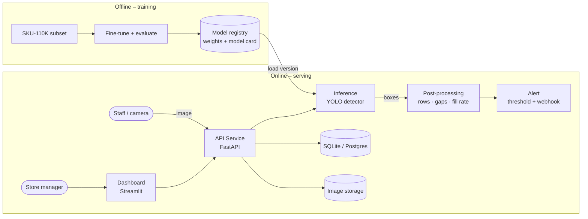

# Retail Shelf Monitoring

> Computer-vision service that analyses a photo of a retail shelf: detects every product, groups
> them into shelf rows, finds empty gaps, computes the fill rate and raises an out-of-stock alert
> when the shelf drops below a threshold — with a dashboard for store managers.

| | |
|---|---|
| **Team code** | AIE-01 · AI Engineering track |
| **Members** | Trần Tất Nguyên · Phạm Minh Phú |
| **Mentor** | Lê Trần Tấn Phát |
| **Timeline** | 4 sprints × 1 week · spec v1.0 (14/11/2026) |
| **Status** | 🚧 Sprint 0 – scaffold |

## Highlights

- **Dense object detection** (YOLO) fine-tuned on SKU-110K, with pretrained vs fine-tuned mAP comparison
- **Offline / online separation** through a versioned **model registry** (weights + checksum + model card)
- **Pure-Python post-processing** (rows, gaps, fill rate) unit-tested with synthetic boxes — no GPU in CI
- **Production-style API**: input validation, standard 4xx errors, JSON logs with per-step latency and model version
- **Reproducible training**: committed configs, seeds, dataset version and results log
- **Delivery**: Docker Compose (API + Streamlit dashboard), GitHub Actions CI, load testing

## Architecture



## Repository structure

```text
retail-shelf-monitoring/
├── shelfmon/                 # core package
│   ├── inference/            # Detector protocol, YoloDetector, FakeDetector, registry loader
│   ├── postprocess/          # filtering, rows, gaps, fill_rate, visualize (pure Python)
│   ├── alert.py · pipeline.py · schemas.py · config.py · cli.py
├── services/
│   ├── api/                  # FastAPI app + Dockerfile
│   └── dashboard/            # Streamlit app + Dockerfile
├── training/                 # configs/, scripts/ (prepare_subset, train, evaluate, export_model), results.csv
├── models/                   # registry: <version>/MODEL_CARD.md + SHA256SUMS (weights git-ignored)
├── data/                     # SKU-110K raw + subset (git-ignored)
├── tests/                    # unit/, data/
├── docs/                     # PRD, DESIGN, adr/, reports/, EVAL_REPORT ...
├── docker-compose.yml
├── Makefile
└── .env.example
```

## Getting started

```bash
cd retail-shelf-monitoring
python -m venv .venv && source .venv/bin/activate
make install          # API + post-processing + dashboard, no PyTorch
make test
make run              # http://localhost:8000/docs
make install-ml       # when you need the detector or training (PyTorch + Ultralytics)
```

With Docker (CPU image with Ultralytics):

```bash
cp .env.example .env
make up               # API :8000 · dashboard :8501
```

Analyze an image:

```bash
curl -F "image=@shelf.jpg" -F "store_id=S001" http://localhost:8000/v1/analyze
```

## Requirements traceability

| ID | Requirement | Priority | Where | Status |
|---|---|---|---|---|
| FR-01 | `POST /v1/analyze` (JPG/PNG ≤ 10 MB, store_id) → boxes, count, gaps, fill rate, id | Must | `services/api`, `pipeline.py` | 🟨 contract + pipeline wiring |
| FR-02 | Annotated image via `GET /v1/analyses/{id}/image` | Must | `postprocess/visualize.py` | ⬜ |
| FR-03 | Rows by vertical position + gaps > k × mean width | Must | `postprocess/rows.py`, `gaps.py` | ⬜ tests ready |
| FR-04 | Fill rate per row + image; alert below threshold (80%) | Must | `fill_rate.py`, `alert.py` | 🟨 alert rule done |
| FR-05 | History in DB; `GET /v1/analyses` filtered by store & time | Must | `services/api` | ⬜ |
| FR-06 | `/health` + standard errors for bad / wrong / oversized images | Must | `services/api` | 🟨 health done |
| FR-07 | Dashboard: history, filters, annotated images, alerts | Should | `services/dashboard` | 🟨 skeleton |
| FR-08 | Batch CLI → CSV | Should | `shelfmon/cli.py` | 🟨 skeleton |
| FR-09 | Webhook alerts (Telegram / Slack) | Could | `alert.py` | ⬜ |
| FR-10 | ROI per camera / store | Could | `pipeline.py` | ⬜ |

| NFR | Target |
|---|---|
| NFR-01 Detection accuracy | mAP@0.5 and mAP@0.5:0.95 on ≥ 200 SKU-110K test images, pretrained vs fine-tuned (reference: mAP@0.5 ≥ 0.75) |
| NFR-02 Gap detection | precision & recall ≥ 0.70 on ≥ 30 self-labeled images |
| NFR-03 Latency | p95 ≤ 2 s/image on lab GPU or ≤ 5 s on CPU (long side ≤ 1920 px), 100-request load test |
| NFR-04 Reliability | no request crashes the service; 100% of bad inputs → 4xx + message |
| NFR-05 Observability | JSON log per request: request_id, step timings, box count, model version |
| NFR-06 Reproducibility | committed training config, seed, data version; weights checksum + link; `docker compose up` |
| NFR-07 Testing | coverage ≥ 60% on post-processing + API; synthetic-box unit tests |

## Sprint plan

| Sprint | Theme | Key outputs |
|---|---|---|
| 1 | Discovery & Design | PRD, Design Doc v0, dataset subset, pretrained baseline mAP |
| 2 | Walking Skeleton | image → detector → post-processing → JSON end-to-end in Docker, Design Doc v1 |
| 3 | Feature Complete & Evaluation | fine-tuned model, annotated images, history, dashboard, Eval Report, Model Card |
| 4 | Hardening & Release | load test, error handling, `rsm-v1.0.0`, Runbook, Postmortem |

## Licenses

| Component | License / terms |
|---|---|
| This code | MIT |
| Ultralytics YOLO | **AGPL-3.0** — internal educational use only; a distributed product would need a compatible license or a different model (record in an ADR) |
| SKU-110K | Dataset terms from the authors (Goldman et al., CVPR 2019) — research use |
| PyTorch, OpenCV, FastAPI, Streamlit | BSD / Apache-2.0 / MIT / Apache-2.0 |
