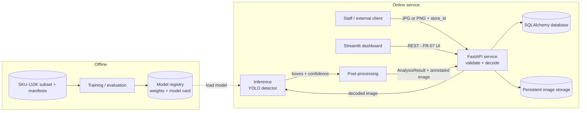
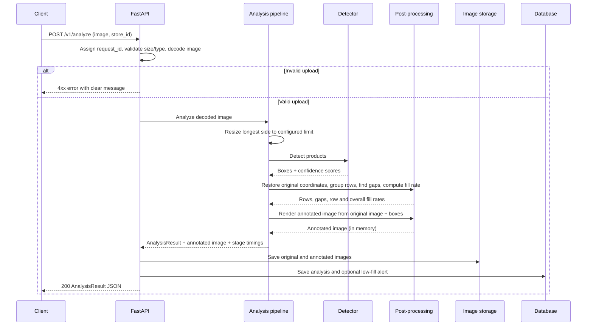
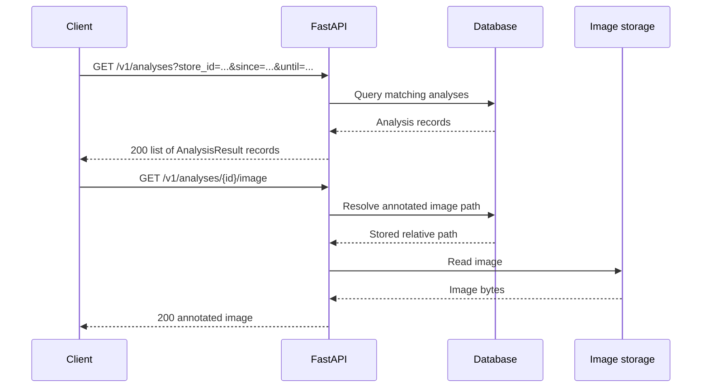
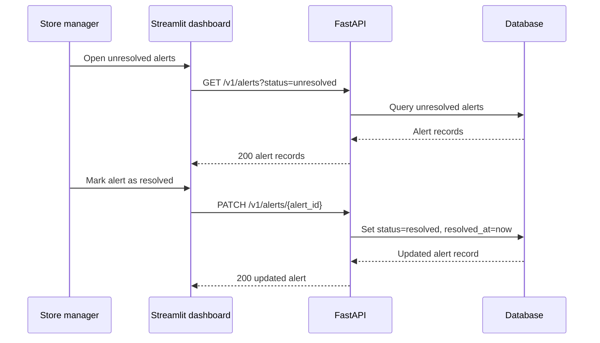
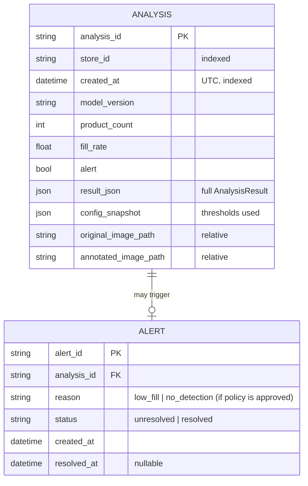

# Design Doc – Retail Shelf Monitoring

**Version:** v0 · **Authors:** Trần Tất Nguyên, Phạm Minh Phú · **Reviewer:** Lê Trần Tấn Phát · **Last updated:** 21/11/2026

## 1. Summary

Retail Shelf Monitoring is a service that takes a shelf photo and returns detected products, empty shelf gaps, row-level and overall fill rates, and a low-stock alert when fill rate falls below a threshold (default 80%). FastAPI validates the image and calls a YOLO detector; a shared pure-Python post-processing module groups boxes into shelf rows, finds gaps, and computes fill rates. Results and original/annotated images are persisted for history and visual verification. Offline training produces versioned model weights and evaluation artifacts consumed by the online inference service. The API and dashboard are intended to run through Docker Compose, subject to the repository's `.env` and model-weight prerequisites.

## 2. Goals / Non-goals

**Goals**

- G1. `POST /v1/analyze` returns boxes, confidence, product count, gaps, fill rate, and `analysis_id` (FR-01).
- G2. Retrieve an annotated image and define row-level gap detection, fill rates, and low-stock alert behavior (FR-02..FR-04).
- G3. Persist and filter analysis history; provide unresolved-alert listing, alert resolution, health checks, and standardized client errors (FR-05..FR-07).
- G4. Define measurable test/evaluation evidence for NFR-01..NFR-07.
- G5. Keep inference and pure post-processing independently testable, using a mocked detector where model weights or GPU are not required.

### Non-goals for this v0

- Exact SKU/brand recognition, planogram compliance, live video, cloud production deployment, authentication/RBAC, or mobile applications.
- Fine-tuning or evaluating a novel detector architecture from scratch.
- Dashboard alert-resolution workflows are included in the expanded FR-07 scope. Batch CLI, outgoing webhooks, and per-camera/store ROI behavior (FR-08..FR-10) remain outside this design scope; the dashboard service may run in Compose, but its non-alert UI workflows are not specified here.

## 3. Architecture overview



| Component | Responsibility | Repository location | Owner |
|---|---|---|---|
| API service | Validate upload, orchestrate inference/post-processing, persist results, return JSON, and expose OpenAPI. | `services/api/` | Nguyên |
| Inference | Load model by version, resize image, run detector, and return boxes with confidence. | `shelfmon/inference/` | Phú (model), Nguyên (integration) |
| Post-processing | Filter confidence, cluster rows, detect gaps, compute fill rates, decide low-fill alerts, and render the annotated image in memory; it performs no persistence or network I/O. | `shelfmon/postprocess/`, `shelfmon/alert.py` | Phú (geometry), Nguyên (alert/persistence integration) |
| Database and image storage | Store analysis/alert metadata and original/annotated image files; persist an `Alert` record when an analysis triggers an alert. | API persistence layer and configured image directory | Nguyên |
| Dashboard service | Runs with the API in Compose; lists unresolved alerts and provides the mark-as-resolved workflow for FR-07. Other dashboard workflows remain outside this design scope. | `services/dashboard/` | Nguyên |
| Training pipeline | Prepare subset, fine-tune/evaluate, and publish weight/version metadata. | `training/`, `models/` | Phú |

The repository already has these module boundaries, but several are not implemented yet: API analysis/history/image routes return 501, YOLO inference and post-processing functions are TODOs, and database persistence is not present. The architecture is viable for the single-host educational MVP; this document specifies intended behavior rather than claiming those paths are complete.

### Key design principles

- **Thin API, shared core.** Keep orchestration and HTTP concerns in FastAPI while the CLI, API, and tests reuse the `shelfmon/` analysis pipeline.
- **Deterministic post-processing.** Keep row clustering, gap detection, and fill-rate calculations independent of database and network I/O so they can be tested with synthetic boxes.
- **Configuration over hidden constants.** Keep confidence, gap, alert, upload-size, and resize thresholds configurable; record the values used when persisting an analysis where practical.
- **One explicit coordinate contract.** Return and annotate boxes in original-image pixel coordinates even when inference runs on a resized image.

### ML ↔ backend contract (v0)

The existing `shelfmon/schemas.py` Pydantic models define the canonical response fields shared by post-processing and FastAPI. The logical boundary is `boxes + image size + post-processing configuration -> AnalysisResult`; post-processing does not perform I/O. `BoundingBox` coordinates use `xyxy` pixel values. The detector may run on a resized image, so the pipeline must convert coordinates back to the original uploaded image before returning results and drawing annotations. Annotation rendering is a separate in-memory function that takes the decoded image and the resulting `AnalysisResult`; it does not change the geometry contract or perform persistence. Align any implementation changes to this contract and update the schema and tests together.

## 4. Main flows

### 4.1 Analyze a shelf image



Validate actual upload bytes and decode before inference. Blocking image/model work must not block the async event loop; use a synchronous FastAPI route or explicitly offload work to a bounded worker thread. A request is successful only after its required result and storage operations succeed; clean up temporary files if persistence fails.

### 4.2 Retrieve analysis history or annotated image



### Dashboard alert flow



The dashboard calls `GET /v1/alerts?status=unresolved` to show alerts requiring attention. When a manager acknowledges an alert, it calls `PATCH /v1/alerts/{alert_id}` with `{"status": "resolved"}`. The API updates the database record and sets `resolved_at`; no user identity is recorded because authentication/RBAC is outside the current scope.

### 4.3 Post-processing baseline

1. Filter detections below `CONF_THRESHOLD`.
2. Group boxes by vertical center using a tolerance relative to median box height; sort rows top-to-bottom and boxes left-to-right. This baseline is sensitive to perspective/tilted shelves and must be evaluated on representative examples. The vertical-center tolerance method is the v0 baseline. In Sprint 2, the team will compare it with vertical-axis DBSCAN on representative images before selecting the row-clustering method.
3. For each row, first merge overlapping boxes into a union of x-intervals, then compute the uncovered horizontal intervals between neighboring boxes and the analysis-area edges. Flag a gap when its width is greater than `GAP_WIDTH_MULTIPLIER × mean box width in that row`.
4. Row fill rate is the union length of product x-intervals divided by the analysis width. Overall fill rate is the arithmetic mean of row fill rates; each detected row contributes equally, regardless of height or box count. If there are no detected rows, the value is determined by the no-detection policy below (provisionally `0.0`).
5. For analyses with at least one detected row, set `alert = true` when the overall fill rate is below `FILL_RATE_ALERT_THRESHOLD` (default `0.80`) and create a corresponding alert record during persistence. If no rows are detected, follow the separate no-detection policy below; its alert behavior remains provisional.

**No-detection case (proposal pending confirmation).** One possible policy is to return `fill_rate = 0.0`, `alert = true`, and persist an alert reason of `no_detection`, distinguishing it from `low_fill`. This is not a frozen contract until Phú/mentor confirms whether an image with zero detections should trigger a restock alert; see section 11.

The full image width is the v0 analysis width because per-store ROI is out of scope. This can misstate fill rate when the shelf occupies only part of the image. `GAP_WIDTH_MULTIPLIER` currently defaults to `1.5`; it is configurable and must be tuned against labeled gap examples before treating it as an empirically validated value.

## 5. API

Base path `/v1`. FastAPI generates OpenAPI from request and response models.

| Method | Path | Request | Response | Errors |
|---|---|---|---|---|
| `POST` | `/v1/analyze` | Multipart `image` (JPG/PNG, ≤10 MB) and `store_id` matching `^[A-Za-z0-9_-]{1,64}$` | `200`: `AnalysisResult` JSON shown below | `413` oversized; `415` unsupported format; `422` corrupt/undecodable image or invalid `store_id`/form; `500` unexpected processing/storage error |
| `GET` | `/v1/analyses` | Optional `store_id`, `since`, `until`; bounded `limit` | `200`: list of matching `AnalysisResult` records, newest first | `422` invalid time range/filter |
| `GET` | `/v1/analyses/{analysis_id}/image` | Path `analysis_id` | `200`: annotated image (`image/jpeg` or `image/png` matching stored output) | `404` analysis/image not found |
| `GET` | `/v1/alerts?status=unresolved` | Optional `status` filter; default `unresolved` for dashboard view | `200`: alert records, newest first | `422` invalid status |
| `PATCH` | `/v1/alerts/{alert_id}` | JSON `{"status": "resolved"}` | `200`: updated alert record with `resolved_at` | `404` alert not found; `422` invalid status or transition |
| `GET` | `/health` | None | `200`: API status and version; this is a liveness check, not a guarantee that inference dependencies are ready | No dependency-specific `503` in this v0 contract |

### `POST /v1/analyze` response contract

The JSON structure below follows the existing Pydantic schema field names and nesting. Numeric values are illustrative; all box/gap coordinates are pixels relative to the original uploaded image. `timings_ms` contains the measured pipeline stages and may include additional stages in future versions.

```json
{
  "analysis_id": "a1b2c3d4e5f6478899aabbccddeeff00",
  "store_id": "S001",
  "created_at": "2026-11-20T12:30:00Z",
  "model_version": "yolov8n-pretrained",
  "product_count": 2,
  "boxes": [
    {"x1": 25.0, "y1": 50.0, "x2": 75.0, "y2": 140.0, "confidence": 0.91, "label": "product"},
    {"x1": 175.0, "y1": 50.0, "x2": 225.0, "y2": 140.0, "confidence": 0.88, "label": "product"}
  ],
  "rows": [
    {
      "index": 0,
      "y1": 50.0,
      "y2": 140.0,
      "boxes": [
        {"x1": 25.0, "y1": 50.0, "x2": 75.0, "y2": 140.0, "confidence": 0.91, "label": "product"},
        {"x1": 175.0, "y1": 50.0, "x2": 225.0, "y2": 140.0, "confidence": 0.88, "label": "product"}
      ],
      "gaps": [{"row_index": 0, "x1": 75.0, "y1": 50.0, "x2": 175.0, "y2": 140.0}],
      "fill_rate": 0.4
    }
  ],
  "gaps": [{"row_index": 0, "x1": 75.0, "y1": 50.0, "x2": 175.0, "y2": 140.0}],
  "fill_rate": 0.4,
  "alert": true,
  "timings_ms": {"preprocess": 12.0, "inference": 480.0, "postprocess": 9.0}
}
```

This response contract intentionally uses the current model fields: `BoundingBox` has `x1/y1/x2/y2/confidence/label`; `ShelfRow` has `index/y1/y2/boxes/gaps/fill_rate`; `AnalysisResult` has `analysis_id/store_id/created_at/model_version/product_count/boxes/rows/gaps/fill_rate/alert/timings_ms`. It does not include `request_id`, image dimensions, alert object, or image URL; request IDs and stage timings belong in structured logs per NFR-05. Update the Pydantic schema and this contract together if the response fields change.

### Error behavior

Return a clear, stable error message for invalid input, without exposing stack traces or local paths. Use `413` for the upload limit, `415` for unsupported format, and `422` for corrupt/undecodable image bytes or invalid form fields. This distinguishes corrupted bytes from unsupported media while satisfying the PRD's requirement that both receive a 4xx response.

All error responses use one body shape (the FastAPI default `detail` is wrapped by an exception handler so validation errors look the same):

```json
{ "error": { "code": "IMAGE_TOO_LARGE", "message": "Image exceeds the 10 MB limit." } }
```

Codes: `IMAGE_TOO_LARGE` (413), `UNSUPPORTED_FORMAT` (415), `INVALID_IMAGE` and `VALIDATION_ERROR` (422), `NOT_FOUND` (404), `INTERNAL_ERROR` (500).

## 6. Data model

The MVP needs one analysis record per successful request and a low-fill alert record only when the threshold is crossed. Persist result fields needed for history plus the complete response payload (JSON) so the analysis can be reconstructed without re-running inference.



| Entity | Fields | Purpose |
|---|---|---|
| `Analysis` | `analysis_id` (PK), `store_id`, `created_at` (UTC), `model_version`, `product_count`, `fill_rate`, `alert`, `result_json`, `config_snapshot`, `original_image_path`, `annotated_image_path` | Analysis history and full result; composite index on (`store_id`, `created_at`) for filters. `config_snapshot` records the thresholds used, so old results stay interpretable after configuration changes. |
| `Alert` | `alert_id` (PK), `analysis_id` (FK), `reason` (`low_fill`; optionally `no_detection` if approved), `status` (`unresolved` or `resolved`), `created_at`, `resolved_at` (nullable) | Records the alert required by FR-04. New alerts start as `unresolved`; the FR-07 dashboard can list unresolved alerts and mark them `resolved`, setting `resolved_at`. No `resolved_by` is stored because authentication/RBAC is outside the current scope. |

Store image paths relative to a configurable image directory; do not persist absolute host paths or image bytes in SQLite. Before using it in a path, validate `store_id` as `^[A-Za-z0-9_-]{1,64}$` and reject invalid values with `422`. The original and annotated image files must live on persistent storage, for example `{IMAGE_DIR}/{store_id}/{analysis_id}_original.jpg` and `..._annotated.jpg`. Database engine and image-storage backend remain PRD open questions: SQLite plus the existing Compose named volume and local image directory are proposed for single-host MVP, pending team/mentor decision and ADR.

**Data lifecycle.** Records and images are kept until manually removed; there is no automatic retention policy in v0, which is a known limitation to document in the Runbook.

## 7. Alternatives considered

| Concern | v0 choice | Alternative | Rationale / trade-off |
|---|---|---|---|
| Detector integration | In-process detector behind `Detector` interface | Separate inference service/queue | In-process is simpler and lower-latency for one host; a separate worker is unnecessary at MVP scale. Use a bounded worker thread for blocking inference. |
| Test detector | `FakeDetector` in tests | Load YOLO weights in every unit test | Fake detector makes API and geometry tests deterministic and fast; real-model quality is covered by evaluation, not unit tests. |
| Database | SQLite proposed for local MVP | PostgreSQL from first sprint | SQLite needs no service container and fits low-volume single-host use. Revisit for concurrent writers or multiple replicas; decision remains open until ADR. |
| Image storage | Local persistent volume proposed | MinIO/object store | Local volume is simple for a single Compose host; MinIO adds operational work but is appropriate if multi-host sharing is required. Decision remains open until ADR. |

## 8. Testing and evaluation

| Requirement | Verification evidence |
|---|---|
| FR-01 | API integration test for valid JPG/PNG, fields, response schema, product count, boxes, gaps, fill rate, and `analysis_id`. |
| FR-02 | Test annotation rendering and retrieval endpoint for a completed analysis, including unknown analysis ID. |
| FR-03 | Deterministic synthetic-box tests for row clustering, sorted order, overlapping boxes, interior/edge gaps, and threshold boundaries. |
| FR-04 | Test row/overall fill calculations, no detections, threshold equality, and below-threshold alert creation (including the `reason` value if approved). |
| FR-05 | Persistence/API tests for saved results and filtering by `store_id`, `since`, and `until`; verify image paths are retained. |
| FR-06 | Negative API tests for corrupt bytes, unsupported formats, oversize uploads, and valid `/health`; assert 4xx errors do not crash the service and use the standard error body. |
| FR-07 | Dashboard/API integration tests verify unresolved alerts are listed, marking an alert resolved updates `status` and `resolved_at`, and resolved alerts no longer appear in the default unresolved filter. |
| NFR-01 | Evaluate pretrained baseline and fine-tuned model on fixed 200-image test split; report mAP@0.5 and mAP@0.5:0.95. |
| NFR-02 | Evaluate gap precision/recall on at least 30 annotated images with documented labels and IoU matching in `EVAL_REPORT.md`. |
| NFR-03 | 100-request API load test on images with longest side ≤1920 px; record hardware, warm-up, concurrency, and p95. Check configured detector `max_det` for truncation on dense validation images. |
| NFR-04 | Run the complete invalid-input suite, defined as: corrupt image, wrong format, over 10 MB, empty file, missing `store_id`, invalid filter parameters. Every invalid request returns a 4xx response and leaves the service available. |
| NFR-05 | Verify structured request logs include request ID, per-stage timings, detection count, and model version; never log image bytes/secrets. |
| NFR-06 | Two separate checks. (a) Rebuild dataset manifests with committed config/seed, verify model checksum/metadata, and smoke-test Compose startup plus `/health` in CI (add the dashboard health check once the dashboard exists). (b) The "start within 15 minutes from a clean clone" criterion is verified by a walkthrough of the README by someone outside the team in Sprint 4; CI cannot measure it. |
| NFR-07 | `pytest --cov` reports coverage for post-processing and API; target ≥60%. PRD defines this as a reported metric, not a CI-enforced threshold; enforcing `--cov-fail-under=60` is a follow-up once real code exists (not in Sprint 1, where tests are nearly empty). |

## 9. Operations

- API listens on port `8000`; Docker Compose also starts the Streamlit dashboard on `8501`. The dashboard is a client of the API; its FR-07 alert workflows are specified in this document, while other dashboard workflows remain outside the current scope.
- Use the persistent Compose volume for the SQLite file and configured image directory in the single-host MVP. Model files are read-only and versioned under `models/`; weights are not committed to Git.
- Configure `DATABASE_URL`, `IMAGE_DIR`, `MODEL_DIR`, `MODEL_VERSION`, `DEVICE`, `IMGSZ`, `MAX_UPLOAD_MB`, `MAX_IMAGE_SIDE`, `CONF_THRESHOLD`, `GAP_WIDTH_MULTIPLIER`, and `FILL_RATE_ALERT_THRESHOLD` through environment variables. Keep `.env` private and `.env.example` safe.
- Load the detector once at startup and warm it up where practical. Bound concurrent inference according to available CPU/GPU memory.
- Emit structured JSON logs per request with request ID, stage timings, detection count, model version, and status. `/health` reports API liveness and version; dependency readiness can be added separately if operational monitoring needs it.
- Compose currently requires `.env` because it declares `env_file: .env`; clean-clone documentation must explain creating it from `.env.example`. A model-weight file may also be needed for real inference. Do not claim `docker compose up` is self-sufficient until these prerequisites are resolved.
- SQLite and local files are single-host MVP choices, not a multi-replica production storage design.

## 10. Security and privacy

- Authentication/RBAC is out of scope; do not expose the service to an untrusted public network.
- Enforce upload size using actual bytes, verify the image by decoding rather than trusting the filename, and reject corrupt/unsupported content before inference. Also cap the decoded pixel count to guard against decompression bombs.
- Generate server-side analysis IDs and filenames. Validate `store_id` with an allow-list (`^[A-Za-z0-9_-]{1,64}$`) before constructing paths, and resolve image paths beneath the configured storage directory (reject any path that escapes it); do not return local paths to clients.
- Keep `.env`, raw images, generated subset images, labels, and model weights out of Git. Do not log image bytes, secrets, or webhook credentials.
- Follow the dataset and model license terms documented in `data/README.md` and the model card; educational-use assumptions are not commercial-use permission.

## 11. Risks and open questions

| Risk / question | Mitigation / next action |
|---|---|
| Row clustering can fail on tilted, occluded, or irregular shelves. | Use height-relative baseline clustering; document failure modes and evaluate representative images. |
| Empty-gap labels are subjective and gaps can be occluded. | Define annotation rules and cross-check labels before reporting NFR-02. |
| Dense images may be truncated by detector `max_det`. | Record the setting and verify predictions on dense validation images before publishing model metrics; do not treat ground-truth max box count as a prediction count. |
| CPU inference may miss p95 target. | Benchmark nano/small and report hardware, warm-up, image size, concurrency, and measured p95. |
| SQLite vs PostgreSQL is unresolved in PRD. | Treat SQLite as provisional for local MVP; confirm with mentor and record an ADR before calling it final. |
| Local volume vs MinIO is unresolved in PRD. | Use local persistent storage only for single-host MVP if approved; revisit for multi-host use and record an ADR. |
| Gap multiplier is not validated. | Keep it configurable (current default `1.5`) and tune on the annotated gap set. |
| Overall fill-rate definition may not match shelf geometry. | v0 uses the arithmetic mean of row fill rates and full image width; confirm the definition and document its limitation before evaluation. |
| A row with a few false-positive boxes can distort the overall fill rate. | Evaluate on dense and sparse examples; consider a minimum box count per row if this appears in error analysis. |
| Empty detections can come from a detector failure or a non-shelf image, not an empty shelf. | Decide whether such cases should raise an alert and whether to record a reason; see open decision 3. |

### Open decisions

1. Confirm SQLite + persistent local volume as the single-host default, or use PostgreSQL/MinIO from the start (PRD section 9).
2. Confirm `1.5×` mean row box width as the initial gap threshold until it is tuned on labeled images (PRD section 9).
3. Confirm the no-detection behavior: should zero detections produce `fill_rate = 0.0` and an alert with `reason = no_detection`, or should the response instead indicate that analysis was inconclusive without triggering a restock alert?
4. Confirm the overall fill-rate definition (full image width, arithmetic mean of rows) with Phú, and whether row-level alerts are needed in addition to the overall alert. Also confirm whether `mean box width in that row` (gap threshold) is measured on the original boxes or on the merged x-intervals, since the two differ for heavily overlapping boxes.
5. Confirm the standardized error body; request IDs remain in structured logs and are not part of the response model in this v0.
